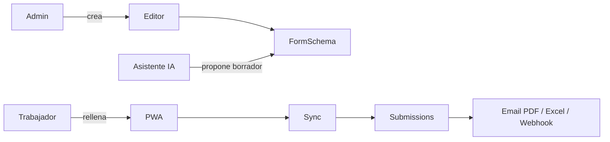
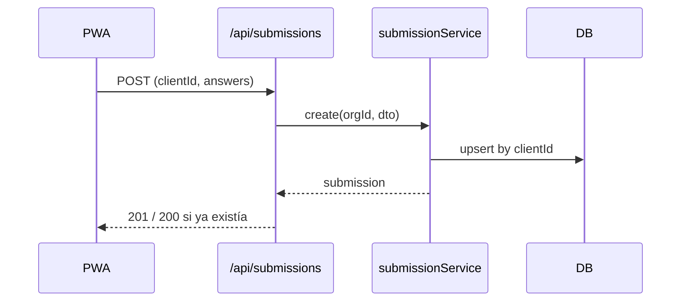

# Arquitectura de software

## Principios para este proyecto

1. **Monolito modular.** Una sola aplicación Next.js. Los módulos son carpetas con límites claros (`src/server/<modulo>`, `src/lib/<modulo>`), no servicios separados. Nada de microservicios ni colas en el piloto.
2. **El esquema del formulario es el contrato central.** Editor, IA, renderizador, PDF y exportaciones dependen de `form-schema`; `form-schema` no depende de nadie.
3. **Dependencias en una sola dirección.** Interfaz → entrada (route handler / server action) → servicio → repositorio → base de datos. Ningún módulo importa la interfaz de otro.
4. **Multi-tenant por diseño.** `organizationId` viaja desde la sesión hasta el repositorio; ninguna consulta sin él.
5. **Sin conexión primero en el móvil.** El cliente guarda en IndexedDB y sincroniza; el servidor es idempotente por `clientId`.
6. **Lo simple gana.** Si dos opciones cumplen los requisitos, la más fácil de cambiar. Optimiza solo con un dato medido.
7. **Seguridad y RGPD por defecto.** Almacenamiento privado, URLs firmadas, nada de datos personales en logs, la IA nunca ve respuestas.

## Cómo diseñar un módulo

1. **Responsabilidad** en una frase. Si necesitas "y", quizá son dos módulos.
2. **Interfaz pública**: qué ofrece a otros módulos (funciones, endpoints, eventos) y qué consume.
3. **Datos**: entidades que posee (solo un módulo es dueño de cada entidad) y cuáles solo lee.
4. **Flujos principales**: un diagrama por flujo no trivial.
5. **Calidades**: sin conexión, rendimiento, seguridad, privacidad, observabilidad.
6. **Riesgos y alternativas**: qué podría salir mal en la demo y el plan B.

## Diagramas (Mermaid)

Contexto o componentes:



Secuencia para flujos entre módulos:



Estados para entidades con ciclo de vida (`stateDiagram-v2`) y ER para el modelo conceptual (`erDiagram`).

## Registro de decisiones (ADR)

Para cada decisión que cueste deshacer, crea `specs/<modulo>/adr-NNN-<titulo-corto>.md`:

```markdown
# ADR-NNN: <título>
- Estado: propuesta | aceptada | sustituida por ADR-MMM
- Fecha: AAAA-MM-DD
## Contexto
## Opciones consideradas (con pros y contras)
## Decisión
## Consecuencias
```

## Lista de comprobación antes de dar el diseño por bueno

- [ ] Cada entidad tiene un único módulo dueño.
- [ ] No hay dependencias circulares entre módulos.
- [ ] El flujo funciona sin conexión donde lo exige el requisito.
- [ ] El aislamiento entre organizaciones está garantizado.
- [ ] Hay forma de probar cada criterio de aceptación.
- [ ] El recorrido de la demo de `CLAUDE.md` sigue funcionando.
