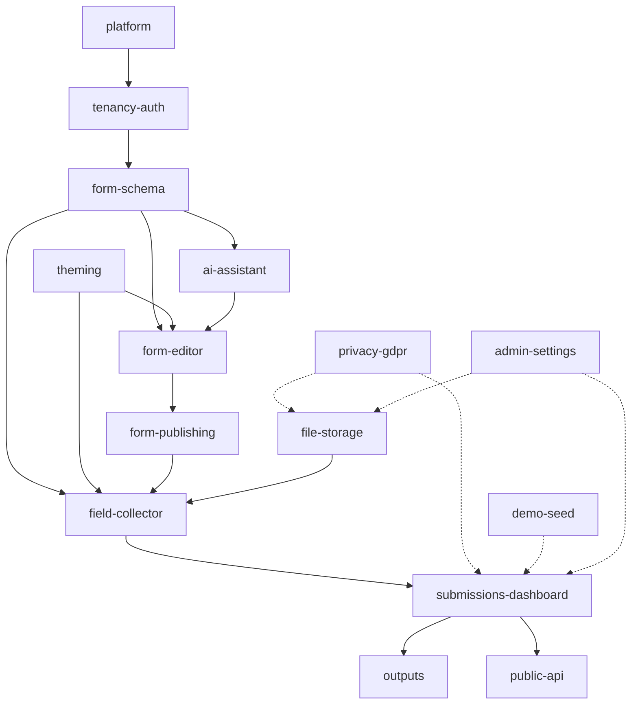

# Especificaciones de FormIA

Fuente de verdad de los módulos del proyecto. Cada subdirectorio es un módulo con, al menos, un `README.md` de requisitos. Las convenciones completas están en [`CLAUDE.md`](../CLAUDE.md#especificaciones-specs) y en la skill [`spec-writing`](../.claude/skills/spec-writing/SKILL.md).

- `README.md` de cada módulo: requisitos. Los escribe el agente **analyst-programmer** en la etapa `design`, bajo la revisión del **architect**.
- `design.md` de cada módulo: diseño técnico, también del **analyst-programmer**.
- `test-plan.md` de cada módulo: plan de pruebas que el **analyst-programmer** escribe en la etapa `design` y ejecuta en la etapa `testPR` (etiqueta `pr-raised`), sobre la rama de la PR, antes de fusionarla.
- Para crear un módulo: copiar [`_template/`](_template/) y añadirlo a esta tabla.

## Mapa de módulos

## Índice

| Orden | Módulo | Prefijo | Resumen | Estado |
| --- | --- | --- | --- | --- |
| 1 | [platform](platform/README.md) | `PLT` | Proyecto base, docker-compose, comandos, CI y despliegue | diseñado |
| 2 | [tenancy-auth](tenancy-auth/README.md) | `AUT` | Organizaciones, usuarios, roles, inicio de sesión y aislamiento | diseñado |
| 3 | [form-schema](form-schema/README.md) | `FSC` | Esquema JSON versionado del formulario (Zod), tipos de campo y lógica condicional | diseñado |
| 4 | [theming](theming/README.md) | `THM` | Logo, colores y tipografía por organización | borrador |
| 5 | [file-storage](file-storage/README.md) | `STO` | Fotos, firmas y logos en almacenamiento privado con URLs firmadas | diseñado |
| 6 | [field-collector](field-collector/README.md) | `COL` | PWA para rellenar formularios en el móvil, sin conexión, con foto, firma y GPS | borrador |
| 7 | [form-editor](form-editor/README.md) | `EDT` | Editor visual con arrastrar y soltar | diseñado |
| 8 | [form-publishing](form-publishing/README.md) | `PUB` | Publicación, versiones, modo de acceso, enlace y código QR | diseñado |
| 9 | [ai-assistant](ai-assistant/README.md) | `AI` | Creación y modificación de formularios con IA a partir de texto o foto | borrador |
| 10 | [submissions-dashboard](submissions-dashboard/README.md) | `SUB` | Recepción de respuestas, listado, ficha y filtros | diseñado |
| 11 | [outputs](outputs/README.md) | `OUT` | Email con PDF, Excel, CSV y webhooks | requisitos listos |
| 12 | [public-api](public-api/README.md) | `API` | API REST de solo lectura con claves por organización | borrador |
| 13 | [privacy-gdpr](privacy-gdpr/README.md) | `GDPR` | RGPD transversal: logs, retención, exportación y borrado de una organización | borrador |
| 14 | [demo-seed](demo-seed/README.md) | `SEED` | Datos de ejemplo y recorrido de la demo con Playwright | borrador |
| 15 | [admin-settings](admin-settings/README.md) | `SET` | Sección de ajustes para administradores y planes de uso con límites por formulario | diseñado |

El orden es el de construcción recomendado; los módulos transversales (`privacy-gdpr`) aplican desde el principio.

## Estados

`borrador` → `requisitos listos` → `diseñado` → `en desarrollo` → `hecho`.
