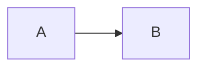

# <Nombre del módulo>

- **Prefijo:** `<MOD>`
- **Estado:** borrador | requisitos listos | diseñado | en desarrollo | hecho
- **Responsable:** analyst-programmer (escribe), architect (revisa)
- **Issues:** #<issue de analysis>, #<issue de design>

## Objetivo

<Qué resuelve este módulo y para quién, en dos o tres frases.>

## Alcance

**Incluido**
- …

**Fuera de alcance**
- …

## Actores

| Actor | Qué hace en este módulo |
| --- | --- |
| Administrador | … |

## Requisitos funcionales

| ID | Prioridad | Requisito |
| --- | --- | --- |
| RF-<MOD>-01 | Must | El sistema debe… |

## Requisitos no funcionales

| ID | Prioridad | Requisito |
| --- | --- | --- |
| RNF-<MOD>-01 | Must | … |

## Flujos principales

## Datos

<Entidades que posee el módulo y entidades que solo lee. Modelo conceptual, sin detalles de Prisma.>

## Dependencias

- Depende de: [`<modulo>`](../<modulo>/README.md) — <para qué>
- Lo usan: …

## Criterios de aceptación

- **CA-<MOD>-01** — Dado … Cuando … Entonces …

## Supuestos y preguntas abiertas

- …

## Historial de cambios

- AAAA-MM-DD — Creación del módulo (#<issue>)
