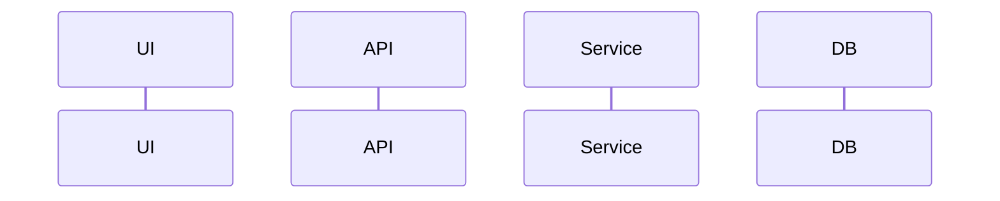

# <Nombre del módulo> — Diseño técnico

- **Requisitos:** [README.md](README.md)
- **Dueño del diseño:** analyst-programmer
- **Issues:** #<analysis>

## Resumen

<Cómo se resuelve técnicamente, en un párrafo.>

## Modelo de datos

```prisma
// cambios en prisma/schema.prisma
```

- Índices y restricciones: …
- Migración: `<nombre>`

## Estructura de ficheros

| Capa | Ruta | Responsabilidad |
| --- | --- | --- |
| Esquema | `src/lib/<modulo>/<modulo>.schema.ts` | … |
| Repositorio | `src/server/<modulo>/<modulo>.repository.ts` | … |
| Servicio | `src/server/<modulo>/<modulo>.service.ts` | … |
| Entrada | `src/app/api/<recurso>/route.ts` | … |
| Interfaz | `src/app/...`, `src/components/<modulo>/...` | … |

## Contratos

### Endpoints

| Método | Ruta | Rol | Entrada | Respuestas |
| --- | --- | --- | --- | --- |
| POST | `/api/...` | admin | `createXInput` | 201 `X`, 400, 403 |

### Funciones

```ts
// firmas de servicios y repositorios
```

## Flujos



## Errores

| Error de dominio | HTTP | Mensaje en la interfaz |
| --- | --- | --- |
| `NotFoundError` | 404 | "No se ha encontrado…" |

## Seguridad y privacidad

- Rol requerido, filtro por `organizationId`, datos personales implicados, logs.

## Tests

| Criterio | Tipo | Fichero |
| --- | --- | --- |
| CA-<MOD>-01 | Vitest | `src/server/<modulo>/<modulo>.service.test.ts` |

## Tareas de desarrollo

| Orden | Issue | Tarea | Depende de |
| --- | --- | --- | --- |
| 1 | #… | … | — |

## Historial de cambios

- AAAA-MM-DD — Diseño inicial (#<issue>)
