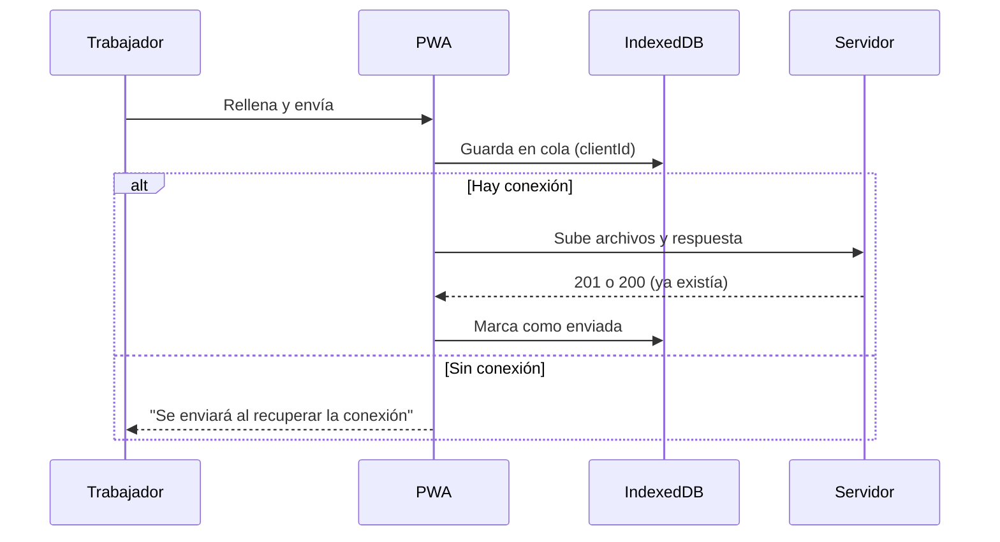

# Recogida en campo (PWA)

- **Prefijo:** `COL`
- **Estado:** diseñado (relleno en línea, #33); PWA y modo sin conexión pendientes
- **Responsable:** analyst-programmer (escribe), architect (revisa)

## Objetivo

Que un trabajador rellene formularios desde el móvil, también sin conexión, capturando fotos, firma y GPS, y que sus respuestas se sincronicen solas al recuperar la red sin duplicarse.

## Alcance

**Incluido**
- Renderizador del formulario a partir del esquema (`form-schema`) y el tema.
- Aplicación web instalable (PWA) con service worker.
- Almacenamiento local con IndexedDB (Dexie): formularios descargados, borradores y cola de envío.
- Captura de foto (cámara o galería), firma táctil y posición GPS.
- Sincronización automática y manual, con estado visible.

**Fuera de alcance**
- Apps nativas, edición de respuestas ya enviadas, mapas offline.

## Requisitos funcionales

| ID | Prioridad | Requisito |
| --- | --- | --- |
| RF-COL-01 | Must | El formulario se abre desde un enlace o QR y se muestra con el tema de la organización. |
| RF-COL-02 | Must | Se renderizan todos los tipos de campo de `form-schema`, aplicando la lógica condicional en tiempo real. |
| RF-COL-03 | Must | Los errores de validación se muestran junto al campo, en español, antes de enviar. |
| RF-COL-04 | Must | La aplicación se puede instalar en la pantalla de inicio (manifest e iconos). |
| RF-COL-05 | Must | Un formulario abierto una vez con conexión se puede volver a abrir y rellenar sin conexión. |
| RF-COL-06 | Must | El progreso se guarda automáticamente como borrador local y se recupera si se cierra la aplicación. |
| RF-COL-07 | Must | Al enviar sin conexión, la respuesta (con sus fotos y firma) queda en una cola local y se envía al recuperar la red. |
| RF-COL-08 | Must | Cada respuesta lleva un `clientId` UUID generado en el dispositivo; reenviarla no crea duplicados. |
| RF-COL-09 | Must | El campo foto permite hacer fotos con la cámara o elegirlas de la galería, según la configuración del campo. |
| RF-COL-10 | Must | El campo firma permite firmar con el dedo, borrar y repetir. |
| RF-COL-11 | Must | El campo GPS captura latitud, longitud, precisión y hora; si el usuario deniega el permiso se informa y, si el campo es obligatorio, no se puede enviar. |
| RF-COL-12 | Must | El usuario ve el estado de cada respuesta: pendiente, enviando, enviada o error, y puede reintentar. |
| RF-COL-13 | Must | La respuesta guarda metadatos: dispositivo, fecha de captura y versión del formulario. |
| RF-COL-14 | Should | Un usuario `collector` ve la lista de formularios de su organización y puede descargarlos para usarlos sin conexión. |
| RF-COL-15 | Must | La pantalla `/f/<slug>` ocupa toda la pantalla y muestra el formulario publicado con dos botones: **Descartar** (pide confirmación si hay algo escrito, no guarda nada y sale) y **Guardar** (valida, envía y muestra confirmación). Descartar vuelve al listado de formularios si hay sesión, o a una pantalla «Rellenado cancelado» si es anónimo. |
| RF-COL-16 | Must | Tras guardar se muestra una confirmación: con sesión se vuelve al listado de formularios; en anónimo se muestra «Gracias» con la opción de rellenar otra vez. Si el envío falla por red, el usuario puede reintentar con el mismo `clientId` sin duplicar la respuesta. |
| RF-COL-17 | Must | Solo se aceptan respuestas de formularios **publicados**, validadas contra la versión publicada que la persona cargó al abrir la pantalla (no la última). El modo de acceso (`registered`/`public`) se comprueba en el servidor en cada subida y en cada guardado, igual que al abrir la pantalla. `organizationId` sale siempre del formulario, nunca del cliente. |
| RF-COL-18 | Must | Foto y firma se suben **antes** de guardar (un `uploadId` UUID por archivo, idempotente) y la respuesta lleva los `FileRef` devueltos. Para el modo `public` existe un punto de subida ligado al `slug` del formulario, con los mismos límites de tipo y tamaño de `file-storage`, que solo admite escribir: nunca permite leer ni listar archivos. |
| RF-COL-19 | Must | En modo `public` la subida y el guardado tienen limitación de tasa por IP y por formulario (HTTP 429 con `Retry-After`) y un campo trampa (honeypot) que descarta los envíos de bots sin guardarlos. Sin CAPTCHA en el piloto. |
| RF-COL-20 | Must | Al guardar, los archivos de la respuesta se enlazan a la `Submission` creada (`attachFilesToSubmission`). Los archivos subidos sin respuesta posterior quedan huérfanos y los trata RF-STO-07 (housekeeper, #24); esta pieza no los borra. |

## Requisitos no funcionales

| ID | Prioridad | Requisito |
| --- | --- | --- |
| RNF-COL-01 | Must | Funciona en Chrome Android y Safari iOS de los dos últimos años. |
| RNF-COL-02 | Must | Diseño móvil primero; usable con una mano en pantallas de 360 px de ancho. |
| RNF-COL-03 | Should | Primera carga del formulario en menos de 3 s en 4G. |
| RNF-COL-04 | Must | Los borradores locales no se envían a ningún sitio salvo al propio servidor de FormIA. |
| RNF-COL-05 | Must | Ni los logs ni los mensajes de error del servidor incluyen el contenido de las respuestas ni las IP en claro (la clave de limitación de tasa se guarda como hash). |

## Flujo principal

## Dependencias

- Depende de: form-schema, theming, form-publishing, file-storage, tenancy-auth.
- Lo usan: submissions-dashboard (recibe las respuestas).

## Criterios de aceptación

- **CA-COL-01** — Dado un formulario abierto con conexión, cuando el dispositivo pasa a modo avión y se rellena y envía, entonces la respuesta queda pendiente y se sube sola al volver la conexión.
- **CA-COL-02** — Dada una respuesta enviada dos veces por un corte de red, cuando llega al servidor, entonces solo existe una `Submission`.
- **CA-COL-03** — Dado un campo que se muestra si "¿Hay incidencias?" es sí, cuando se responde no, entonces el campo no aparece y no se exige.
- **CA-COL-04** — Dado un formulario publicado, cuando se abre `/f/<slug>`, se rellenan todos los campos (incluida una foto y una firma) y se pulsa Guardar, entonces existe una `Submission` con la versión publicada y las imágenes se ven en la ficha del panel mediante URL firmada.
- **CA-COL-05** — Dado que se ha escrito algo, cuando se pulsa Descartar y se confirma, entonces no se crea ninguna `Submission`.
- **CA-COL-06** — Dado un formulario `registered`, cuando entra alguien sin sesión, entonces va a `/login`; con una sesión de otra organización ve «No tienes acceso»; y ni la subida ni el guardado aceptan a esas personas (401/403).
- **CA-COL-07** — Dado un formulario `public`, cuando una persona anónima lo rellena y guarda, entonces se crea la respuesta en la organización del formulario (sin `submittedByUserId`) y no puede escribir en otra.
- **CA-COL-08** — Dado un formulario despublicado, entonces no acepta respuestas (la pantalla lo indica y subida y guardado responden 410).
- **CA-COL-09** — Dado un campo obligatorio vacío, cuando se pulsa Guardar, entonces se muestra el error junto al campo y no se envía nada.
- **CA-COL-10** — Dado un formulario `public`, cuando una misma IP supera el límite de subidas o de guardados, entonces recibe 429; un envío con el honeypot relleno no crea ninguna `Submission`; y el punto de subida pública no permite leer ni listar archivos.

## Supuestos y preguntas abiertas

- Si el formulario se republica mientras hay respuestas en cola, se envían con la versión con la que se rellenaron.
- La pieza #33 cubre solo el relleno **en línea** (RF-COL-01 a 03, 08 a 11, 13 y 15 a 20). PWA, Dexie, borradores locales, cola y estado de envío (RF-COL-04 a 07, 12, 14) quedan para otra pieza; el envío queda detrás de `submit(clientId, answers, files)` para poder poner la cola delante.
- RF-COL-13: en #33 los metadatos guardados son la versión y la fecha de captura; el dispositivo no se guarda porque `createSubmission` no lo admite (pendiente de decidir, ver design.md).
- RF-COL-01: el tema de la organización se aplica con el `theme` que devuelve `getPublishedFormBySlug` (hoy `DEFAULT_THEME`; lo sustituirá `theming`).
- `/collect` (placeholder antiguo, al que redirige `requireAdminPage` a los `collector`) pasa a ser el listado de formularios publicados de la organización con enlace a `/f/<slug>`.

## Historial de cambios

- 2026-11-14 — Creación del módulo.
- 2026-11-26 — RF-COL-15 a RF-COL-20, RNF-COL-05, CA-COL-04 a CA-COL-10 y supuestos de la pantalla de relleno en línea (#33).
