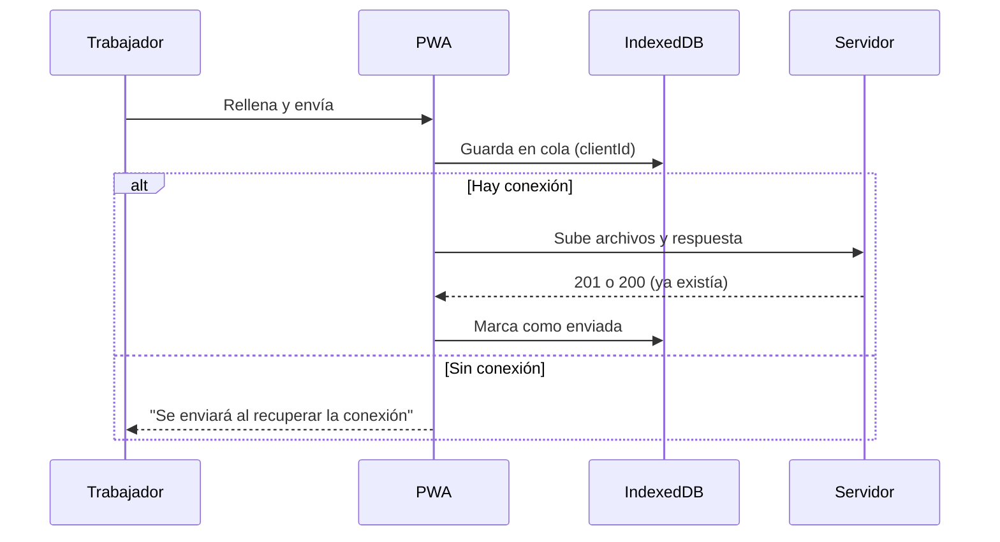

# Recogida en campo (PWA)

- **Prefijo:** `COL`
- **Estado:** borrador
- **Responsable:** analyst-programmer (escribe), architect (revisa)

## Objetivo

Que un trabajador rellene formularios desde el móvil, también sin conexión, capturando fotos, firma y GPS, y que sus respuestas se sincronicen solas al recuperar la red sin duplicarse.

## Alcance

**Incluido**
- Renderizador del formulario a partir del esquema (`form-schema`) y el tema.
- Aplicación web instalable (PWA) con service worker.
- Almacenamiento local con IndexedDB (Dexie): formularios descargados, borradores y cola de envío.
- Captura de foto (cámara o galería), firma táctil y posición GPS.
- Sincronización automática y manual, con estado visible.

**Fuera de alcance**
- Apps nativas, edición de respuestas ya enviadas, mapas offline.

## Requisitos funcionales

| ID | Prioridad | Requisito |
| --- | --- | --- |
| RF-COL-01 | Must | El formulario se abre desde un enlace o QR y se muestra con el tema de la organización. |
| RF-COL-02 | Must | Se renderizan todos los tipos de campo de `form-schema`, aplicando la lógica condicional en tiempo real. |
| RF-COL-03 | Must | Los errores de validación se muestran junto al campo, en español, antes de enviar. |
| RF-COL-04 | Must | La aplicación se puede instalar en la pantalla de inicio (manifest e iconos). |
| RF-COL-05 | Must | Un formulario abierto una vez con conexión se puede volver a abrir y rellenar sin conexión. |
| RF-COL-06 | Must | El progreso se guarda automáticamente como borrador local y se recupera si se cierra la aplicación. |
| RF-COL-07 | Must | Al enviar sin conexión, la respuesta (con sus fotos y firma) queda en una cola local y se envía al recuperar la red. |
| RF-COL-08 | Must | Cada respuesta lleva un `clientId` UUID generado en el dispositivo; reenviarla no crea duplicados. |
| RF-COL-09 | Must | El campo foto permite hacer fotos con la cámara o elegirlas de la galería, según la configuración del campo. |
| RF-COL-10 | Must | El campo firma permite firmar con el dedo, borrar y repetir. |
| RF-COL-11 | Must | El campo GPS captura latitud, longitud, precisión y hora; si el usuario deniega el permiso se informa y, si el campo es obligatorio, no se puede enviar. |
| RF-COL-12 | Must | El usuario ve el estado de cada respuesta: pendiente, enviando, enviada o error, y puede reintentar. |
| RF-COL-13 | Must | La respuesta guarda metadatos: dispositivo, fecha de captura y versión del formulario. |
| RF-COL-14 | Should | Un usuario `collector` ve la lista de formularios de su organización y puede descargarlos para usarlos sin conexión. |

## Requisitos no funcionales

| ID | Prioridad | Requisito |
| --- | --- | --- |
| RNF-COL-01 | Must | Funciona en Chrome Android y Safari iOS de los dos últimos años. |
| RNF-COL-02 | Must | Diseño móvil primero; usable con una mano en pantallas de 360 px de ancho. |
| RNF-COL-03 | Should | Primera carga del formulario en menos de 3 s en 4G. |
| RNF-COL-04 | Must | Los borradores locales no se envían a ningún sitio salvo al propio servidor de FormIA. |

## Flujo principal

## Aceptación de términos y condiciones (#38)

Requisitos de la pantalla de relleno de los formularios `public`. Diseño en [form-publishing](../form-publishing/design.md#términos-y-condiciones-en-formularios-públicos-38). Dependen de la pantalla de relleno de #33 (RF-COL-15 a RF-COL-20, CA-COL-04 a CA-COL-10); los números RF-COL-21 y siguientes dejan sitio a esos.

| ID | Prioridad | Requisito |
| --- | --- | --- |
| RF-COL-21 | Must | En un formulario `public`, `/f/<slug>` muestra, antes de Guardar, una casilla **no marcada por defecto** «He leído y acepto los términos y condiciones y la política de privacidad», con enlaces a ambos textos (los de la versión publicada), y un aviso con el nombre de la organización responsable del tratamiento y la mención de que FormIA actúa como encargado. Guardar sin marcarla muestra el error junto a la casilla y no envía nada. En modo `registered` no aparece. |
| RF-COL-22 | Must | El servidor exige la aceptación al guardar en modo `public` (no basta con la interfaz): sin `acceptedTerms: true`, o con una versión del formulario sin términos, rechaza con 400 y no guarda. Los enlaces y la versión que se registran son los de la versión del formulario guardada en el servidor, no los que envía el cliente. |

- **CA-COL-11** — Dado un formulario `public` con términos, cuando una persona anónima rellena los campos y pulsa Guardar sin marcar la casilla, entonces ve el error junto a la casilla y no se crea ninguna `Submission`; al marcarla y guardar, se crea. En un formulario `registered` no hay casilla.
- **CA-COL-12** — Dado un formulario `public`, cuando alguien envía directamente la petición de guardado sin `acceptedTerms: true`, entonces recibe 400 y no se guarda nada; con `acceptedTerms: true` se guarda la prueba de aceptación con los enlaces de la versión del servidor.

## Dependencias

- Depende de: form-schema, theming, form-publishing, file-storage, tenancy-auth.
- Lo usan: submissions-dashboard (recibe las respuestas).

## Criterios de aceptación

- **CA-COL-01** — Dado un formulario abierto con conexión, cuando el dispositivo pasa a modo avión y se rellena y envía, entonces la respuesta queda pendiente y se sube sola al volver la conexión.
- **CA-COL-02** — Dada una respuesta enviada dos veces por un corte de red, cuando llega al servidor, entonces solo existe una `Submission`.
- **CA-COL-03** — Dado un campo que se muestra si "¿Hay incidencias?" es sí, cuando se responde no, entonces el campo no aparece y no se exige.

## Supuestos y preguntas abiertas

- Si el formulario se republica mientras hay respuestas en cola, se envían con la versión con la que se rellenaron.

## Historial de cambios

- 2026-11-14 — Creación del módulo.
- 2026-11-27 — Issue #38: sección «Aceptación de términos y condiciones» (RF-COL-21, RF-COL-22, CA-COL-11, CA-COL-12).
