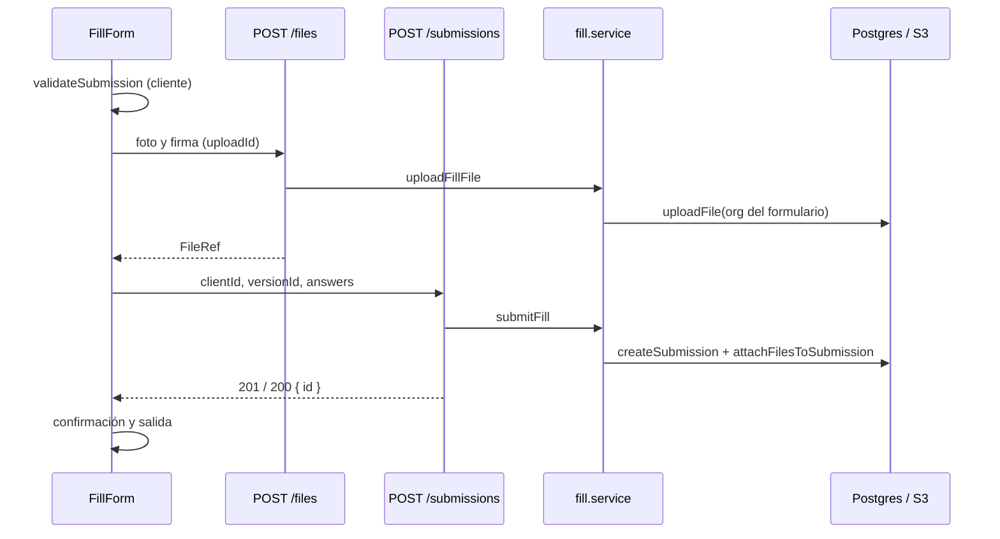

# Recogida en campo (PWA) — Diseño técnico

- **Requisitos:** [README.md](README.md)
- **Responsable:** analyst-programmer (escribe), architect (revisa)
- **Issues:** #33 (relleno en línea). El resto del módulo (PWA, Dexie, cola) se diseñará en otra pieza.

## Resumen

`/f/<slug>` pasa de marcador a pantalla de relleno. La página (Server Component) sigue resolviendo el acceso con `getFormForFilling` y entrega a un componente cliente `FillForm` la versión publicada (`versionId`, `schema`, `theme`). El cliente valida con `validateSubmission` (mismo Zod que el servidor), sube foto y firma a un punto de subida ligado al `slug` y envía la respuesta con `submit(clientId, answers, files)`. El servidor vuelve a comprobar acceso y estado, carga la versión indicada, llama a `createSubmission` (idempotente por `clientId`) y enlaza los archivos. Los mismos dos endpoints sirven para `registered` (con sesión) y `public` (anónimo): el actor sale de la sesión, nunca del cliente. Sin migraciones ni dependencias nuevas.

## Modelo de datos

Sin cambios en `prisma/schema.prisma`. Se reutilizan `Submission`, `StoredFile` y `FormVersion`.

## Estructura de ficheros

| Capa | Ruta | Responsabilidad |
| --- | --- | --- |
| Validación | `src/lib/field-collector/fill.schema.ts` | `fillSubmissionBodySchema`, `FILL_RATE_LIMITS`, constantes |
| Lógica pura | `src/lib/field-collector/answers.ts` | `hasAnyAnswer`, `collectFileKeys`, `emptyAnswers` |
| Lógica pura | `src/lib/field-collector/geolocation.ts` | `toGpsAnswer(position)`, `geolocationErrorMessage(code)` |
| Cliente (envío) | `src/lib/field-collector/submit.ts` | `submit(...)` y `uploadFile(...)` (fetch); punto único donde se pondrá la cola |
| Servicio | `src/server/field-collector/fill.service.ts` | `uploadFillFile`, `submitFill` |
| Límite de tasa | `src/server/field-collector/fill-rate-limit.ts` | `assertWithinFillLimit(kind, slug, ip)` sobre `server/auth/rate-limit.ts` |
| Entrada | `src/app/api/public/forms/[slug]/files/route.ts` | `POST` subida (solo escritura) |
| Entrada | `src/app/api/public/forms/[slug]/submissions/route.ts` | `POST` guardar |
| Interfaz | `src/app/f/[slug]/page.tsx` | sustituye el marcador (`TODO(field-collector)`) por `<FillForm />` |
| Interfaz | `src/app/f/[slug]/thanks/page.tsx`, `cancelled/page.tsx` | pantallas anónimas finales |
| Interfaz | `src/components/field-collector/fill-form.tsx` | estado, validación, botones, diálogo Descartar |
| Interfaz | `src/components/field-collector/field-renderer.tsx` | un componente por tipo; `visibleIf` en tiempo real con `isFieldVisible` |
| Interfaz | `src/components/field-collector/photo-input.tsx`, `signature-pad.tsx`, `gps-input.tsx` | foto (`<input type=file accept="image/*" capture>`), firma (canvas con pointer events, sin dependencia), GPS |
| Interfaz | `src/app/collect/page.tsx` | listado de formularios publicados de la organización (reemplaza el placeholder) |
| Repositorio | `src/server/form-publishing/form-publishing.repository.ts` | añade `listPublishedForms(organizationId)` |

## Contratos

### Endpoints

Ambos usan `export const runtime = "nodejs"` y `dynamic = "force-dynamic"`, `Cache-Control: no-store`, y responden `{ error: { code, message } }` como `/api/files`.

| Método | Ruta | Actor | Entrada | Respuestas |
| --- | --- | --- | --- | --- |
| POST | `/api/public/forms/[slug]/files` | sesión de la org o anónimo (si `public`) | multipart: `file`, `kind` (`photo` \| `signature`; `document` → 400), `uploadId` UUID | 201 `UploadedFile` (nuevo), 200 (ya existía), 400, 401, 403, 404, 409, 410, 413, 415, 429 |
| POST | `/api/public/forms/[slug]/submissions` | igual | JSON `FillSubmissionBody` | 201 `{ id, created: true }`, 200 `{ id, created: false }`, 400 `{ error:{code:"VALIDATION"}, fieldErrors }`, 401, 403, 404, 409, 410, 413, 429 |

Este módulo **no expone GET** de archivos: la lectura sigue siendo `/api/files` (con sesión) y la ficha del panel.

### Funciones

```ts
// src/lib/field-collector/fill.schema.ts
export const fillSubmissionBodySchema = z.object({
  clientId: z.string().uuid(),
  versionId: z.string().min(1),          // versión que vio quien rellena
  capturedAt: z.string().datetime(),     // + refine: no posterior a now + 24 h (si no, 400)
  answers: z.record(z.string(), z.unknown()),
  website: z.string().optional(),        // honeypot: debe venir vacío
});
export type FillSubmissionBody = z.infer<typeof fillSubmissionBodySchema>;

// Valores por defecto; se pueden sobrescribir con FILL_RATE_LIMIT_UPLOAD y FILL_RATE_LIMIT_SUBMIT
// (enteros > 0; si no son válidos se usa el valor por defecto). Los tests leen estos valores, no números fijos.
export const FILL_RATE_LIMITS = {
  upload: { limit: 200, windowMs: 10 * 60_000 },
  submit: { limit: 60, windowMs: 10 * 60_000 },
} as const;

// src/lib/field-collector/answers.ts
export function hasAnyAnswer(answers: Record<string, unknown>): boolean; // true si algún valor isAnswered
export function collectFileKeys(schema: FormVersion, answers: Record<string, unknown>): string[]; // claves de photo/signature visibles

// src/lib/field-collector/submit.ts (cliente)
export type FillFiles = Record<string /*fieldId*/, Array<{ uploadId: string; kind: "photo" | "signature"; blob: Blob }>>;
export type SubmitResult = { id: string; created: boolean };
export async function submit(
  ctx: { slug: string; versionId: string; capturedAt: string },
  clientId: string,
  answers: Record<string, unknown>,
  files: FillFiles,
): Promise<SubmitResult>; // sube cada archivo (mismo uploadId al reintentar), pone los FileRef en answers y hace POST

// src/server/field-collector/fill.service.ts
export async function uploadFillFile(
  slug: string,
  user: CurrentUser | null,
  input: { kind: "photo" | "signature"; uploadId: string; bytes: Uint8Array },
): Promise<{ file: UploadedFile; created: boolean }>;
export async function submitFill(
  slug: string,
  user: CurrentUser | null,
  body: FillSubmissionBody,
): Promise<{ id: string; created: boolean }>;
export class FormClosedError extends Error {}  // → 410

// src/server/field-collector/fill-rate-limit.ts
export function clientIp(headers: Headers, hops?: number): string;
// x-forwarded-for se separa por comas y se recorta; se toma el valor contando `hops` desde el FINAL
// (hops = 1 → el último, el que añadió el proxy de confianza). `hops` por defecto: env TRUSTED_PROXY_HOPS (entero ≥ 1, por defecto 1).
// Si hay menos valores que hops, se usa el primero; sin cabecera o vacía → "unknown". Nunca el primer valor por defecto: lo escribe el cliente.
export function assertWithinFillLimit(kind: "upload" | "submit", slug: string, ip: string): void; // lanza RateLimitError (429)
export function clearFillLimitsForTests(): void;
```

Reglas de `uploadFillFile`:

1. `getFormForFilling(slug, user)`: lanza `NotFoundError`, `UnauthorizedError`, `ForbiddenError`; `state: "closed"` → `FormClosedError`.
2. `kind` ∈ {photo, signature}.
3. `uploadFile(form.organizationId, …)` (organización **del formulario**, no del cliente). El `uploadId` solo es único dentro de esa organización, por lo que un `uploadId` repetido en otra no pisa nada.

Reglas de `submitFill`:

1. Igual 1 que arriba. Si `body.website` no está vacío → devuelve `{ id: "", created: false }` sin guardar (el handler responde 201 `{ id: "", created: true }`, para no avisar al bot).
2. `getFormVersion(body.versionId)`; debe existir y cumplir `formId === form.formId` y `organizationId === form.organizationId`; si no, `ValidationError` (400). Se acepta una versión anterior a la publicada actual.
3. `createSubmission({ organizationId: form.organizationId, actor, form: { id, title: form.name, versionId, versionNumber, schema }, clientId, answers, capturedAt })`, con `actor` = `{ kind: "user", userId, userName: user.name, userOrganizationId }` si hay sesión; `{ kind: "anonymous" }` si no.
4. `attachFilesToSubmission(organizationId, collectFileKeys(schema, submission.answers), submission.id)` (también cuando `created = false`; es idempotente). **Solo se enlazan `StoredFile` sin `submissionId`** (o ya enlazados a esta misma `Submission`); uno enlazado a otra `Submission` nunca se reasigna. El desarrollador debe comprobarlo en `linkToSubmission`/`attachFilesToSubmission` de `file-storage` (pieza ya fusionada): si hoy reasigna, se ajusta ahí con el cambio mínimo (`updateMany` con `where: { submissionId: null }`) y su test. Si el ajuste exige cambiar un contrato de `file-storage` más allá de eso, se detiene y pregunta en el issue.
5. Registrar solo `{ event: "fill.submitted", formId, created }`; nunca `answers` ni la IP.

Los handlers: `clientIp` → `assertWithinFillLimit` **solo si no hay sesión** (modo `public` anónimo) → `*Service`. Orden en el handler de subida: comprobar `content-length` como `/api/files` (413) antes de leer el multipart. `SubmissionValidationError` → 400 con `fieldErrors: FieldValidationError[]`.

Limitación de tasa: **contador propio, separado del login**. `fill-rate-limit.ts` tiene su propio `Map<string, number[]>` (marcas de tiempo por clave) con su propio tope `MAX_FILL_KEYS = 10_000` (al superarlo se expulsan las claves más antiguas, sin tocar `server/auth/rate-limit.ts`, cuyo comportamiento y `Map` no cambian: así una inundación de IPs falsas nunca desplaza los fallos de login, RNF-AUT-04). Cada llamada a `assertWithinFillLimit` poda las marcas fuera de `windowMs`; si ya hay `limit` marcas lanza `RateLimitError` (con los segundos hasta que caduque la más antigua para `Retry-After`) y, si no, registra la actual. Clave `fill:<kind>:<slug>:<sha256(ip)>`. Es en memoria por proceso: suficiente para el piloto de una instancia; **con varias instancias hará falta un almacén compartido** (Redis o similar), anotado como limitación aceptada. Para anónimos, `limit`/`windowMs` salen de `FILL_RATE_LIMITS`.

### Interfaz

- `FillForm({ slug, form, mode })`, `form: PublishedFormView` sin `organizationId`, `mode: "user" | "anonymous"`.
- `clientId = crypto.randomUUID()` al montar (`useRef`), no cambia hasta guardar con éxito: reintentar reutiliza `clientId`, `uploadId`s y `capturedAt` (fijado al primer Guardar).
- Valores del estado → respuesta: text/time/date/datetime `string`; number `number`; yes_no `boolean`; single_choice `string`; multiple_choice `string[]`; photo `FileRef[]`; signature `FileRef`; gps `GpsAnswer`. Vacío = clave ausente.
- Guardar: `validateSubmission(schema, answers)`; si falla, errores bajo cada campo (`role="alert"`, `data-testid="field-error-<id>"`) y foco al primero; no se llama a la red. Botón desactivado y «Guardando…» durante el envío.
- Descartar: si `hasAnyAnswer` abre `AlertDialog` («¿Descartar lo escrito?», `data-testid="discard-confirm"`); si no, sale directamente. Salida: `mode === "user"` → `/admin/forms` (rol admin) o `/collect` (collector); anónimo → `/f/<slug>/cancelled`.
- Tras guardar: aviso «Respuesta guardada» (`data-testid="save-success"`), y redirección al listado (usuario) o a `/f/<slug>/thanks` (anónimo, enlace «Rellenar otra vez» → `/f/<slug>`).
- GPS: botón «Obtener ubicación» (o automático si `autoCapture`) con `navigator.geolocation.getCurrentPosition`; si se deniega, mensaje «No se pudo obtener la ubicación: permiso denegado» y, si es obligatorio, Guardar muestra el error del campo.
- Foto: `accept="image/jpeg,image/png,image/webp,image/heic"`; `capture="environment"` solo si `allowGallery === false`; respeta `maxPhotos`. Firma: PNG del canvas, botones Borrar/Repetir.
- Layout: columna única, `min-h-dvh`, botones fijos abajo (`sticky`), objetivos táctiles ≥ 44 px; legible a 360 px y con teclado virtual. Tema: variables CSS `--primary`/fuente a partir de `form.theme` en el contenedor.
- `/collect`: lista de `listPublishedForms(user.organizationId)` (nombre + enlace `/f/<slug>`); sin sesión redirige a `/login`.

## Flujos



## Errores

| Error de dominio | HTTP | Mensaje en la interfaz |
| --- | --- | --- |
| `UnauthorizedError` | 401 | «Inicia sesión para continuar.» |
| `ForbiddenError` | 403 | «No tienes acceso a este formulario.» |
| `NotFoundError` | 404 | «No se ha encontrado el formulario.» |
| `FormClosedError` | 410 | «Este formulario ya no acepta respuestas» |
| `SubmissionValidationError` / `ZodError` / `ValidationError` | 400 | errores junto a cada campo / «Los datos no son válidos.» |
| `ConflictError` | 409 | «Ese identificador ya se usó.» |
| `PayloadTooLargeError` | 413 | «El archivo es demasiado grande (máximo 10 MB).» |
| `UnsupportedMediaTypeError` | 415 | «Tipo de archivo no admitido.» |
| `RateLimitError` | 429 (+ `Retry-After` en segundos) | «Demasiados intentos. Inténtalo de nuevo en unos minutos.» |
| otros | 500 | «Error interno.» (sin detalles) |

El cliente, ante un fallo de red o 5xx, conserva el estado y muestra «No se pudo enviar. Reintentar», reutilizando `clientId`.

## Seguridad y privacidad

- `organizationId` y el actor salen del formulario y de la sesión; el cuerpo no puede traerlos. Un usuario de otra organización en un formulario `registered` recibe 403 también en subida y guardado.
- El punto de subida pública solo tiene `POST`: no hay lectura ni listado. Devuelve solo `key`, `kind`, `contentType`, `sizeBytes`. `createSubmission` rechaza claves que no sean de la organización del formulario (`isOwnFileKey`).
- Un archivo ya enlazado a una `Submission` no se reasigna a otra (ver regla 4 de `submitFill`): un anónimo no puede «robar» la clave de un archivo ajeno de su organización.
- Los archivos subidos sin guardar quedan huérfanos (RF-STO-07, #24); se documenta, no se resuelve aquí.
- Honeypot `website` (campo oculto con `tabIndex=-1`, `autoComplete="off"`, fuera de pantalla). Límite de tasa en memoria; con varias instancias sería por proceso (limitación aceptada en el piloto).
- Logs sin respuestas ni IP en claro (RNF-COL-05).
- Dependencia del proxy de confianza: el primer valor de `x-forwarded-for` lo escribe el cliente, así que **no se usa**. Se toma el valor contando `TRUSTED_PROXY_HOPS` (por defecto 1) desde el final, que es el que añade el proxy de despliegue. Sin cabecera → `unknown` (un único cubo, caso de local). Variables nuevas en `.env.example`: `TRUSTED_PROXY_HOPS=1`, `FILL_RATE_LIMIT_UPLOAD=200`, `FILL_RATE_LIMIT_SUBMIT=60`.

## Tests

| Criterio | Tipo | Fichero |
| --- | --- | --- |
| CA-COL-02 | Vitest (PostgreSQL) | `src/server/field-collector/fill.service.test.ts` (dos `submitFill` con el mismo `clientId` → una `Submission`) |
| CA-COL-03 | Vitest + Playwright | `src/lib/field-collector/answers.test.ts`; `e2e/field-collector-fill.spec.ts` |
| CA-COL-04 | Playwright + Vitest | `e2e/field-collector-fill.spec.ts` (foto, firma, ficha con URL firmada) y `fill.service.test.ts` (enlaza archivos, versión) |
| CA-COL-05 | Playwright | `e2e/field-collector-fill.spec.ts` |
| CA-COL-06 | Vitest + Playwright | `fill.service.test.ts`, `e2e/field-collector-access.spec.ts` |
| CA-COL-07 | Vitest + Playwright | `fill.service.test.ts` (incluye: una clave ya enlazada a otra `Submission` no se reasigna), `e2e/field-collector-access.spec.ts` |
| CA-COL-08 | Vitest + Playwright | `fill.service.test.ts`, `e2e/field-collector-access.spec.ts` |
| CA-COL-09 | Playwright | `e2e/field-collector-fill.spec.ts` |
| CA-COL-10 | Vitest + Playwright | `src/server/field-collector/fill-rate-limit.test.ts` (límite leído de `FILL_RATE_LIMITS`; `clientIp` con `x-forwarded-for: a, b` usa `b`; el contador de fill no desplaza las claves de login), `fill.service.test.ts` (honeypot: sin `Submission` ni archivos enlazados; logs: espía de `console.*` y logger sin valores de `answers` ni IP, RNF-COL-05), `fill.schema.test.ts` (`capturedAt` > now + 24 h → error), `e2e/field-collector-access.spec.ts` |

Los títulos de test incluyen el identificador del criterio (`CA-COL-0N`) para poder seleccionarlos con `-t`/`-g`. Además, tests unitarios de `geolocation.ts`, `fill.schema.ts` y de los handlers (códigos HTTP de la tabla de errores). Los e2e usan imágenes PNG/JPEG pequeñas de `e2e/fixtures/` y `page.mouse` para la firma.

## Tareas de desarrollo

| Orden | Issue | Tarea | Depende de |
| --- | --- | --- | --- |
| 1 | #33 | Relleno en línea de formularios publicados | #25, #26, #27, #28 (en `main`) |

## Historial de cambios

- 2026-11-26 — Diseño inicial de la pantalla de relleno en línea (#33)
- 2026-11-26 — Revisión del arquitecto (#33): `clientIp` por saltos desde el final, límites 60/200 configurables, contador propio de fill, enlace de archivos solo si no están enlazados, `capturedAt` ≤ now + 24 h, test de logs con espías
