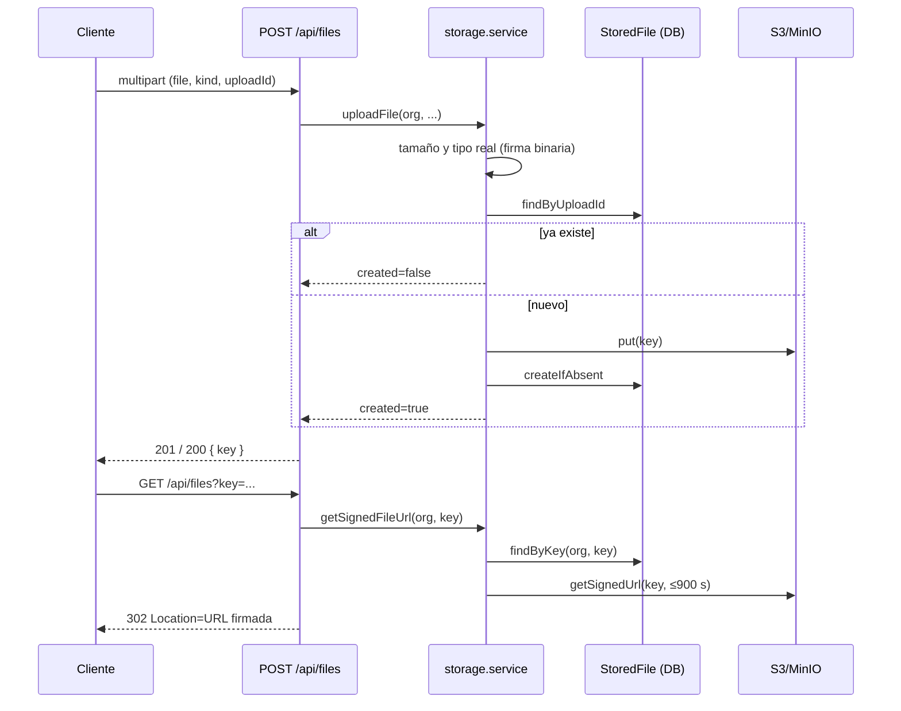

# Almacenamiento de archivos — Diseño técnico

- **Requisitos:** [README.md](README.md)
- **Responsable:** analyst-programmer (escribe), architect (revisa)
- **Issues:** #25 (diseño), padre #23

## Resumen

Se construye un servicio de almacenamiento privado sobre S3 (MinIO en local). Tres decisiones:

1. **La respuesta guarda la clave, no una URL** (RF-STO-08). La clave es `org/<organizationId>/<tipo>/<uploadId>.<ext>`, donde `uploadId` es un UUID generado en el cliente. Como la clave se deriva de `uploadId`, la subida es idempotente por construcción (RF-STO-06): repetirla produce la misma clave.
2. **Una sola ruta de lectura** `GET /api/files?key=...` (RF-STO-09): comprueba sesión y que la clave empieza por `org/<organizationId de la sesión>/` y exista en `StoredFile`; responde `302` a una URL firmada de 900 s como máximo. Panel, PDF y exportación usan esa ruta.
3. **Tabla propia `StoredFile`** (RF-STO-11) con los metadatos, para huérfanos y borrado por organización. Sin clave foránea a `Submission` (mismo criterio que `submissions-dashboard`: `submissionId` es un identificador lógico, porque `field-collector` aún no existe).

Los tipos se validan por **firma binaria** (magic bytes) con una función propia de unas pocas líneas, sin dependencia nueva (JPG `FF D8 FF`, PNG `89 50 4E 47 0D 0A 1A 0A`, WEBP `RIFF....WEBP`, HEIC `ftyp` en los bytes 4-11 (`....ftyp` + marca de 4 bytes en 8-11) `heic|heix|heif|mif1|msf1|hevc`, PDF `%PDF-`).

El adaptador es una interfaz (`StorageAdapter`) con una implementación S3 (`@aws-sdk/client-s3` y `@aws-sdk/s3-request-presigner`, **dependencias nuevas, aprobadas por el arquitecto en #25**; valen para MinIO y para Azure Blob en modo S3). Para los tests unitarios hay una implementación en memoria; el adaptador S3 se prueba contra el MinIO del entorno de pruebas.

Las URLs firmadas se generan para `S3_PUBLIC_ENDPOINT` (opcional; por defecto `S3_ENDPOINT`): dentro de Docker la app habla con `http://minio:9000`, que el navegador no alcanza. Si `S3_PUBLIC_ENDPOINT` está definido, el cliente de firma usa ese host.

## Modelo de datos

```prisma
// prisma/schema.prisma — se añade este bloque

enum StoredFileKind {
  photo
  signature
  document
}

model StoredFile {
  id             String         @id @default(cuid())
  organizationId String
  key            String         @unique       // org/<organizationId>/<kind>/<uploadId>.<ext>
  uploadId       String                       // UUID generado en el cliente (RF-STO-06)
  kind           StoredFileKind
  contentType    String                       // tipo real detectado: image/jpeg, image/png, image/webp, image/heic, application/pdf
  sizeBytes      Int
  submissionId   String?                      // identificador lógico de Submission; SIN relación de Prisma; null = huérfano
  createdAt      DateTime       @default(now())

  organization Organization @relation(fields: [organizationId], references: [id])

  @@unique([organizationId, uploadId])
  @@index([organizationId, submissionId])
  @@index([submissionId, createdAt])
  @@map("stored_files")
}
```

```prisma
model Organization {
  // ...campos existentes, sin cambios...
  storedFiles StoredFile[]
}
```

- `@@unique([organizationId, uploadId])`: garantiza la idempotencia también ante dos peticiones simultáneas (la segunda recibe `P2002` y devuelve el registro existente).
- Huérfano (RF-STO-07): `submissionId IS NULL AND createdAt < now() - 7 días`.
- Migración: `init_file_storage` (`npx prisma migrate dev --name init_file_storage`).

## Variables de entorno

Se añaden a `envSchema` (`src/lib/env.ts`) y a `.env.example`:

| Variable | Esquema Zod | Por defecto | Uso |
| --- | --- | --- | --- |
| `S3_PUBLIC_ENDPOINT` | `z.string().url().optional()` | — (se usa `S3_ENDPOINT`) | Host con el que se firman las URLs que abre el navegador. |
| `STORAGE_MAX_UPLOAD_BYTES` | `z.coerce.number().int().positive()` | `10485760` (10 MB) | Tamaño máximo de subida (RF-STO-04). |
| `STORAGE_SIGNED_URL_TTL_SECONDS` | `z.coerce.number().int().min(1).max(900)` | `900` | Vida de la URL firmada (RF-STO-02). El máximo 900 lo impone el esquema. |

`S3_ENDPOINT`, `S3_REGION`, `S3_ACCESS_KEY`, `S3_SECRET_KEY`, `S3_BUCKET` y `S3_FORCE_PATH_STYLE` ya existen. Nota: `S3_FORCE_PATH_STYLE` usa `z.coerce.boolean()`, con el que la cadena `"false"` se convierte en `true`; **no se toca en #25** (se avisa al arquitecto, ver pregunta 4).

## Estructura de ficheros

| Capa | Ruta | Responsabilidad |
| --- | --- | --- |
| Modelo | `prisma/schema.prisma` (modificar) | `StoredFileKind`, `StoredFile`, relación inversa. |
| Esquema | `src/lib/file-storage/file-storage.schema.ts` | `uploadInputSchema`, `fileKeyQuerySchema`, constantes de tipos admitidos. |
| Lógica pura | `src/lib/file-storage/file-type.ts` | `detectFileType(bytes)`: tipo real por firma binaria. |
| Lógica pura | `src/lib/file-storage/file-key.ts` | `buildFileKey`, `parseFileKey`: construye y analiza claves. |
| Adaptador | `src/server/storage/storage-adapter.ts` | Interfaz `StorageAdapter`. |
| Adaptador | `src/server/storage/s3-storage-adapter.ts` | Implementación S3; `getStorageAdapter()` (singleton perezoso desde `getEnv()`). |
| Adaptador (tests) | `src/server/storage/in-memory-storage-adapter.ts` | Implementación en memoria para tests. |
| Repositorio | `src/server/storage/stored-file.repository.ts` | Consultas Prisma de `StoredFile`, todas con `organizationId` (salvo `findOrphanFiles`, ver abajo). |
| Servicio | `src/server/storage/storage.service.ts` | Subida, URL firmada, vinculación a respuesta. |
| Entrada | `src/app/api/files/route.ts` | `POST` (subida) y `GET` (redirección firmada). |
| Config | `src/lib/env.ts`, `.env.example` (modificar) | Variables nuevas. |
| Entorno de pruebas | `docker-compose.test.yml` (sin cambios si `STORAGE_*` usan su valor por defecto) | El bucket `formia` ya lo crea `minio-init`. |

## Contratos

### Esquemas (`src/lib/file-storage/file-storage.schema.ts`)

```ts
export const STORED_FILE_KINDS = ["photo", "signature", "document"] as const;
export type StoredFileKindValue = (typeof STORED_FILE_KINDS)[number];

/** Tipos admitidos por tipo de archivo (RF-STO-04). */
export const ALLOWED_CONTENT_TYPES: Record<StoredFileKindValue, readonly DetectedContentType[]> = {
  photo: ["image/jpeg", "image/png", "image/webp", "image/heic"],
  signature: ["image/png"],
  document: ["application/pdf"],
};

export const uploadInputSchema = z.object({
  kind: z.enum(STORED_FILE_KINDS),
  uploadId: z.string().uuid(),
});
export type UploadInput = z.infer<typeof uploadInputSchema>;

export const fileKeyQuerySchema = z.object({ key: z.string().min(1).max(300) });
```

### Lógica pura

```ts
// file-type.ts
export type DetectedContentType =
  | "image/jpeg" | "image/png" | "image/webp" | "image/heic" | "application/pdf";
/** Devuelve el tipo por la firma de los primeros bytes, o null si no es ninguno. */
export function detectFileType(bytes: Uint8Array): DetectedContentType | null;
export const EXTENSION_BY_CONTENT_TYPE: Record<DetectedContentType, "jpg" | "png" | "webp" | "heic" | "pdf">;

// file-key.ts
export function buildFileKey(input: {
  organizationId: string; kind: StoredFileKindValue; uploadId: string; contentType: DetectedContentType;
}): string; // org/<organizationId>/<kind>/<uploadId>.<ext>  (RF-STO-01)
/** null si la clave no tiene la forma esperada (no analiza permisos). */
export function parseFileKey(key: string): { organizationId: string; kind: StoredFileKindValue; uploadId: string } | null;
```

### Adaptador

```ts
export interface StorageAdapter {
  /** Guarda el objeto. Sobrescribir la misma clave con el mismo contenido es inocuo. */
  put(input: { key: string; body: Uint8Array; contentType: string }): Promise<void>;
  /** URL firmada GET (expiresInSeconds ≤ 900, si no lanza Error). */
  getSignedUrl(key: string, expiresInSeconds: number): Promise<string>;
  delete(key: string): Promise<void>;
  exists(key: string): Promise<boolean>;
}
export function getStorageAdapter(): StorageAdapter;      // S3, singleton, usa getEnv()
export function setStorageAdapterForTests(adapter: StorageAdapter | null): void;
export function createS3StorageAdapter(config: {
  endpoint: string; publicEndpoint?: string; region: string; accessKey: string;
  secretKey: string; bucket: string; forcePathStyle: boolean;
}): StorageAdapter;
```

- `createS3StorageAdapter` crea dos `S3Client` (uno para operaciones con `endpoint`, otro solo para firmar con `publicEndpoint ?? endpoint`). `getSignedUrl` usa `GetObjectCommand` y `@aws-sdk/s3-request-presigner`. `put` usa `PutObjectCommand` con `ContentType` y **sin ACL**. El bucket nunca se hace público (RNF-STO-01); la app no crea el bucket (lo crea `minio-init`/el despliegue).
- Con Azure Blob en modo S3 basta con cambiar variables (RNF-STO-03); ningún código lee un nombre de proveedor.

### Repositorio (`stored-file.repository.ts`)

```ts
export type StoredFileRecord = {
  id: string; organizationId: string; key: string; uploadId: string;
  kind: StoredFileKind; contentType: string; sizeBytes: number;
  submissionId: string | null; createdAt: Date;
};
export function findByUploadId(organizationId: string, uploadId: string): Promise<StoredFileRecord | null>;
export function findByKey(organizationId: string, key: string): Promise<StoredFileRecord | null>;
/** Inserta; si ya existe (organizationId, uploadId) (P2002) devuelve el existente y created=false. */
export function createIfAbsent(organizationId: string, data: {
  key: string; uploadId: string; kind: StoredFileKind; contentType: string; sizeBytes: number;
}): Promise<{ record: StoredFileRecord; created: boolean }>;
/** Marca los archivos como parte de una respuesta. Devuelve cuántos actualizó (solo de esa organización). */
export function linkToSubmission(organizationId: string, keys: string[], submissionId: string): Promise<number>;
/** RF-STO-07: submissionId null y createdAt < cutoff. Para el script de #24; recibe organizationId opcional. */
export function findOrphanFiles(cutoff: Date, organizationId?: string): Promise<StoredFileRecord[]>;
```

`findOrphanFiles` es la única función sin `organizationId` obligatorio: la usa un script de mantenimiento, nunca una ruta HTTP.

### Servicio (`storage.service.ts`)

```ts
export const MAX_SIGNED_URL_TTL_SECONDS = 900;

export type UploadedFile = { key: string; kind: StoredFileKindValue; contentType: string; sizeBytes: number };

/** Sube y registra. Idempotente por (organizationId, uploadId). Cubre RF-STO-01, 04, 06, 10, 11. */
export function uploadFile(
  organizationId: string,
  input: { kind: StoredFileKindValue; uploadId: string; bytes: Uint8Array },
): Promise<{ file: UploadedFile; created: boolean }>;

/** Cubre RF-STO-02, 03, 09. Lanza NotFoundError si la clave no existe o es de otra organización. */
export function getSignedFileUrl(organizationId: string, key: string): Promise<{ url: string; expiresInSeconds: number }>;

/** Para field-collector (RF-STO-07/08): enlaza claves a una respuesta. */
export function attachFilesToSubmission(organizationId: string, keys: string[], submissionId: string): Promise<number>;
```

Algoritmo de `uploadFile`:

1. `bytes.byteLength === 0` → `ValidationError`. `> STORAGE_MAX_UPLOAD_BYTES` → `PayloadTooLargeError` (nuevo, ver Errores).
2. `detectFileType(bytes)`; si es `null` o no está en `ALLOWED_CONTENT_TYPES[kind]` → `UnsupportedMediaTypeError` (nuevo). **Nada se ha escrito todavía** (CA-STO-04).
3. `findByUploadId`: si existe → devuelve `{ file, created: false }` sin tocar el almacenamiento (CA-STO-05). Si existe con otro `kind` → `ConflictError`.
4. `key = buildFileKey(...)`; `adapter.put(...)`; luego `createIfAbsent(...)`.
   - Si falla el INSERT, se intenta `adapter.delete(key)` (silencioso) y se relanza.
   - Si `createIfAbsent` devuelve `created=false` (subida simultánea con el mismo `uploadId`) y `record.key !== key` (la extensión depende del tipo detectado, así que otro tipo da otra clave), se borra con `adapter.delete(key)` el objeto recién escrito y se devuelve el registro existente con `created: false`. Si `record.key === key` no se borra nada (es el mismo objeto). Si `record.kind` difiere del pedido, se borra igual el objeto sobrante y se lanza `ConflictError`.
5. Registro en log: `{ event: "file.uploaded", key, sizeBytes }` (RNF-STO-04); nunca bytes ni nombre original.

`getSignedFileUrl`: `findByKey(organizationId, key)`; ausente → `NotFoundError` (CA-STO-02, mismo error si la clave no existe: no se revela). TTL = `min(STORAGE_SIGNED_URL_TTL_SECONDS, 900)`.

### Endpoints

Nuevos errores de dominio en `src/lib/errors.ts`:

```ts
export class PayloadTooLargeError extends Error { constructor(message = "El archivo es demasiado grande.") }
export class UnsupportedMediaTypeError extends Error { constructor(message = "Tipo de archivo no admitido.") }
```

| Método | Ruta | Rol | Entrada | Respuestas |
| --- | --- | --- | --- | --- |
| POST | `/api/files` | cualquier sesión (admin o collector) | `multipart/form-data`: `file` (File), `kind`, `uploadId` | 201 `{ key, kind, contentType, sizeBytes }` (nuevo); 200 mismo cuerpo (repetido); 400 (campos inválidos o archivo vacío); 401; 409 (`uploadId` ya usado con otro `kind`); 413; 415 |
| GET | `/api/files?key=<clave>` | cualquier sesión | `key` | 302 con `Location` = URL firmada y `Cache-Control: no-store`; 400 (falta `key`); 401; 404 (no existe o es de otra organización) |

Detalles de `route.ts`:

- `export const runtime = "nodejs"; export const dynamic = "force-dynamic"` (o `await connection()` como `/api/health`, según lo que admita el build con Cache Components).
- `POST`: `requireSession()`; si `Content-Length` > `STORAGE_MAX_UPLOAD_BYTES + 1 MB` → 413 sin leer el cuerpo; `await request.formData()`; `file` debe ser `File`; `uploadInputSchema.safeParse({ kind, uploadId })`; `new Uint8Array(await file.arrayBuffer())`; `uploadFile(user.organizationId, ...)`. **No se usa** `file.type` ni `file.name`.
- `GET`: `requireSession()`, `fileKeyQuerySchema`, `getSignedFileUrl(user.organizationId, key)`, `Response.redirect(url, 302)` con `Cache-Control: no-store`.
- Cuerpo de error: `{ error: { code, message } }`, igual que el resto de rutas; la traducción de errores de dominio a HTTP se hace en una función local `toErrorResponse(error)` (401 `UnauthorizedError`, 403 `ForbiddenError`, 404, 409, 413, 415, 400 `ValidationError`/Zod, 500 resto sin detalles).

## Flujos



## Errores

| Error de dominio | HTTP | Mensaje en la interfaz |
| --- | --- | --- |
| `UnauthorizedError` | 401 | "Inicia sesión para continuar." |
| `ValidationError` | 400 | "Los datos de subida no son válidos." |
| `NotFoundError` | 404 | "No se ha encontrado el archivo." |
| `ConflictError` | 409 | "Ese identificador de subida ya se usó con otro tipo de archivo." |
| `PayloadTooLargeError` | 413 | "El archivo es demasiado grande (máximo 10 MB)." |
| `UnsupportedMediaTypeError` | 415 | "Tipo de archivo no admitido." |

## Seguridad y privacidad

- Bucket privado; el único acceso es la URL firmada de ≤ 15 min (RF-STO-02, RNF-STO-01). La respuesta `302` lleva `Cache-Control: no-store`.
- La pertenencia se comprueba contra la tabla (`findByKey` filtra por `organizationId`), no solo por el prefijo de la clave. Una clave inexistente y una de otra organización devuelven el mismo 404.
- El tipo se decide por el contenido; el `Content-Type` guardado en S3 es el detectado, no el declarado. Los PDF y HEIC se sirven como descarga inline por el navegador (el cliente decide); no se ejecuta contenido activo.
- No se guarda nombre original del archivo (puede contener datos personales).
- Logs solo con `key` y `sizeBytes` (RNF-STO-04). Los metadatos de la petición (`FormData`) nunca se registran.
- Datos personales: las fotos y firmas pueden serlo; alojamiento en la UE depende del despliegue (RNF-STO-02, ya cubierto por `platform`).
- **Límite de tamaño en el despliegue:** un proxy como nginx (1 MB por defecto) puede devolver 413 antes de llegar a la app. En el despliegue, `client_max_body_size` debe ser ≥ `STORAGE_MAX_UPLOAD_BYTES` (más el margen de 1 MB del multipart). Si no, fallarán las fotos del móvil en la demo.
- **Lectura por cualquier sesión de la organización:** un `collector` puede abrir cualquier archivo de su organización si conoce la clave. Es aceptable en el piloto: la clave lleva un UUID no enumerable.
- **S3_PUBLIC_ENDPOINT en producción:** cómo se expone el almacenamiento al navegador (nginx delante de MinIO, Azure o S3 público) lo decide el despliegue, no #25. En `.env.example` la variable va comentada o vacía: si apuntara a `localhost`, el entorno de pruebas firmaría URLs inalcanzables desde el contenedor `tests`.
- **Riesgo HEIC:** los navegadores no muestran HEIC en ``. Se guarda tal cual; `field-collector` y el panel tendrán que tenerlo en cuenta (no se convierte en #25).

## Tests

| Criterio | Tipo | Fichero |
| --- | --- | --- |
| RF-STO-01, RF-STO-04 | Vitest | `src/lib/file-storage/file-type.test.ts`, `src/lib/file-storage/file-key.test.ts` |
| CA-STO-01 | Vitest (integración con MinIO, `STORAGE_INTEGRATION=1`) | `src/server/storage/s3-storage-adapter.integration.test.ts` |
| CA-STO-02 | Vitest | `src/server/storage/storage.service.test.ts`, `src/app/api/files/route.test.ts` |
| CA-STO-03 | Vitest | `src/server/storage/storage.service.test.ts`, `src/app/api/files/route.test.ts` |
| CA-STO-04 | Vitest | `src/server/storage/storage.service.test.ts`, `src/app/api/files/route.test.ts` |
| CA-STO-05 | Vitest (integración con Prisma) | `src/server/storage/stored-file.repository.test.ts`, `storage.service.test.ts` |
| RF-STO-07 (criterio) | Vitest | `src/server/storage/stored-file.repository.test.ts` |
| RNF-STO-01, RNF-STO-03 | Vitest (integración con MinIO) | `src/server/storage/s3-storage-adapter.integration.test.ts` |
| RNF-STO-04 | Vitest | `src/server/storage/storage.service.test.ts` |

**Nombres obligatorios de `describe`/`it`:** los casos del plan filtran con `-t`; si el texto no aparece, Vitest ejecuta 0 tests y sale con código 0. Cada filtro tiene que encontrar al menos los tests indicados en el plan:

| Filtro `-t` | Texto que debe contener el nombre del test | Mínimo |
| --- | --- | --- |
| `expired` | "expired" (URL caducada, 403) | 1 |
| `privado` | "privado" (bucket sin firma, 403) | 1 |
| `otra organización` | "otra organización" | 2 |
| `firmada` | "firmada" | 2 |
| `rechaza` | "rechaza" | 5 |
| `idempot` | "idempotente" | 4 |
| `huérfan` | "huérfanos" | 3 |
| `STORAGE\|S3_PUBLIC\|log` | "STORAGE…", "S3_PUBLIC_ENDPOINT…", "log…" | 3 |

Los tests del servicio usan `InMemoryStorageAdapter` y un repositorio con Prisma real (como `submission.repository.test.ts`) o mockeado, según el patrón del módulo vecino. Los de la ruta mockean `requireSession` y el servicio. Los de integración con MinIO se saltan si `STORAGE_INTEGRATION` no vale `1` (`describe.skipIf`), porque en el desarrollo sin MinIO no deben fallar; el plan de pruebas los activa.

## Tareas de desarrollo

| Orden | Issue | Tarea | Depende de |
| --- | --- | --- | --- |
| 1 | #25 | Todo lo descrito arriba (una sola PR) | — |
| 2 | #24 | Script de borrado de huérfanos y por organización (usa `findOrphanFiles`) | #25 |
| 3 | `field-collector` | Subida pública anónima, reducción en dispositivo (RF-STO-05), `attachFilesToSubmission` | #25 |

## Límite de tamaño por plan (#40)

En `uploadFile`, tras el chequeo contra `STORAGE_MAX_UPLOAD_BYTES` y antes de `detectFileType`, se consulta `getEffectiveLimits(organizationId).maxFileBytes` (módulo `admin-settings`); si no es nulo y `bytes.byteLength` lo supera, `PayloadTooLargeError` con el mensaje «El archivo supera el tamaño máximo de tu plan (X MB).» (413, sin cambios en la ruta). Detalle en [`admin-settings/design.md`](../admin-settings/design.md#uploadfile-rf-set-12).

## Historial de cambios

- 2026-11-27 — Límite de tamaño de archivo por plan (#40).

- 2026-11-26 — Revisión del arquitecto: borrado del objeto sobrante en la carrera con extensiones distintas, notas de despliegue (nginx), HEIC y lectura por sesión (#25).
- 2026-11-26 — Diseño inicial: adaptador S3, tabla `StoredFile`, rutas `POST`/`GET /api/files`, URLs firmadas (#25).
