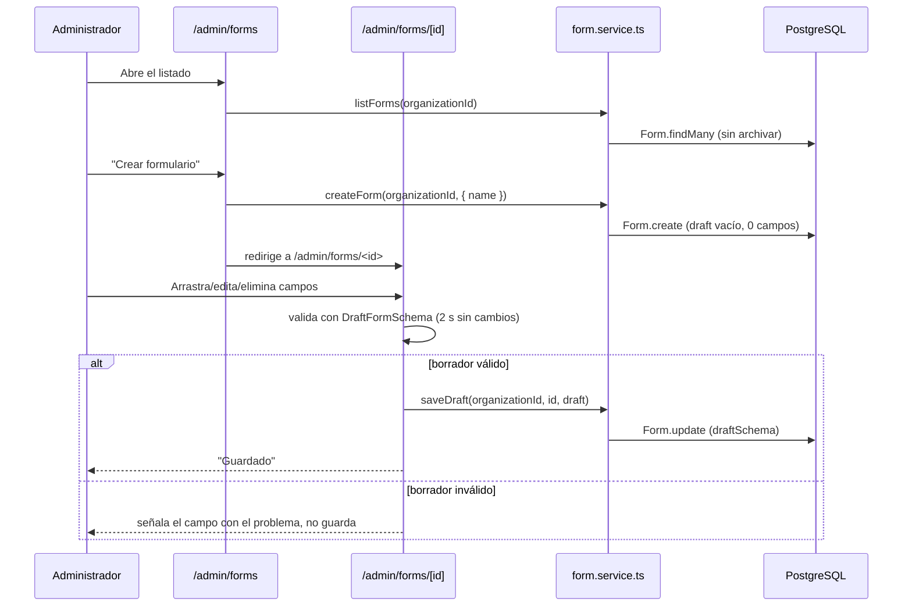

# Editor visual de formularios

- **Prefijo:** `EDT`
- **Estado:** diseñado
- **Responsable:** analyst-programmer (escribe), architect (revisa)
- **Issues:** #1 (análisis), #6 (diseño)

## Objetivo

Que un administrador sin conocimientos técnicos cree y ajuste formularios con arrastrar y soltar, viendo en todo momento cómo quedará en el móvil.

## Alcance

**Incluido**
- Lista de formularios de la organización (crear, duplicar, archivar).
- Lienzo con los campos, paleta de tipos y panel de propiedades.
- Arrastrar y soltar para añadir y reordenar (dnd-kit).
- Configuración de lógica condicional básica.
- Vista previa móvil.
- Punto de entrada al asistente de IA.

**Fuera de alcance**
- Edición colaborativa en tiempo real, historial de deshacer entre sesiones.
- En esta pieza (#6): lógica real del asistente de IA (RF-EDT-12, solo el hueco de interfaz) y tema real de la organización en la vista previa (RF-EDT-09, usa un tema por defecto fijo); ver "Supuestos y preguntas abiertas".

## Actores

| Actor | Qué hace en este módulo |
| --- | --- |
| Administrador | Lista, crea, duplica, archiva y edita formularios; arrastra y ordena campos; configura lógica condicional; revisa la vista previa móvil. |
| form-schema | Valida cada campo (`FieldSchema`) y aporta los tipos de campo y sus opciones; el editor construye un borrador con ellos. |
| tenancy-auth | Protege `/admin/forms/**` (solo rol `admin`) y aporta el `organizationId` de la sesión. |

## Requisitos funcionales

| ID | Prioridad | Requisito |
| --- | --- | --- |
| RF-EDT-01 | Must | El administrador ve el listado de formularios con nombre, estado, versión publicada, número de respuestas y fecha de modificación. |
| RF-EDT-02 | Must | Puede crear un formulario vacío, desde el asistente de IA o duplicando otro. |
| RF-EDT-03 | Must | Puede añadir campos arrastrándolos desde la paleta o pulsándolos. |
| RF-EDT-04 | Must | Puede reordenar campos arrastrando, también con teclado (accesibilidad). |
| RF-EDT-05 | Must | Puede editar las propiedades de cada campo: etiqueta, descripción, obligatorio y opciones específicas del tipo. |
| RF-EDT-06 | Must | Puede eliminar y duplicar campos. |
| RF-EDT-07 | Must | Puede definir una condición de visibilidad para un campo eligiendo campo origen, operador y valor. |
| RF-EDT-08 | Must | El borrador se guarda automáticamente; se indica "Guardado" o "Guardando…". |
| RF-EDT-09 | Must | Se muestra una vista previa con apariencia de móvil y el tema de la organización. |
| RF-EDT-10 | Must | El editor impide guardar un esquema inválido y señala el campo con el problema. |
| RF-EDT-11 | Should | Deshacer y rehacer dentro de la sesión (Ctrl+Z / Ctrl+Y). |
| RF-EDT-12 | Must | Desde el editor se puede pedir a la IA que modifique el formulario actual; el cambio propuesto se muestra antes de aplicarse. |

## Requisitos no funcionales

| ID | Prioridad | Requisito |
| --- | --- | --- |
| RNF-EDT-01 | Must | Uso principal en ordenador; usable en tablet. |
| RNF-EDT-02 | Should | Fluido con formularios de hasta 100 campos. |

## Flujos principales

## Datos

- **Posee:** `Form` (borrador del esquema como JSON, nombre, estado `draft`/`published`, fecha de archivado). Todavía no crea `FormVersion` ni `Submission`: son de `form-publishing` y `submissions-dashboard` respectivamente (ver "Supuestos y preguntas abiertas"); mientras no existan, el listado muestra placeholders fijos para "versión publicada" (siempre "Sin publicar") y "número de respuestas" (siempre 0).
- **Lee:** `Organization`/`User` de `tenancy-auth` (vía `requireAdminPage`/`getCurrentOrg`, solo para la sesión y el filtro multi-tenant, sin tocar sus tablas). Usa los tipos y esquemas de `form-schema` (`Field`, `FieldSchema`, `FIELD_TYPES`) para construir y validar los campos del borrador.

## Dependencias

- Depende de: [`form-schema`](../form-schema/README.md) (tipos y validación de campos), [`tenancy-auth`](../tenancy-auth/README.md) (sesión, rol admin, `organizationId`). `theming` y `ai-assistant` no tienen issue propio todavía: se usan un tema por defecto fijo y un hueco de interfaz sin lógica respectivamente (ver "Supuestos y preguntas abiertas").
- Lo usan: form-publishing (toma el borrador validado para crear la primera `FormVersion` al publicar).

## Criterios de aceptación

- **CA-EDT-01** — Dado un formulario con tres campos, cuando se arrastra el tercero a la primera posición y se recarga la página, entonces el orden se conserva.
- **CA-EDT-02** — Dado un campo con condición sobre otro, cuando se elimina el campo origen, entonces el editor avisa y elimina o pide corregir la condición.
- **CA-EDT-03** — Dado un cambio en un campo, cuando pasan 2 s, entonces el borrador queda guardado sin pulsar ningún botón.
- **CA-EDT-04** — Dado un administrador que crea un formulario vacío con un nombre, cuando se abre el listado, entonces aparece con ese nombre, estado "draft", "Sin publicar" y 0 respuestas.
- **CA-EDT-05** — Dado un formulario con campos, cuando se duplica, entonces existen dos formularios independientes con el mismo contenido de campos y nombres distintos, y editar uno no cambia el otro.
- **CA-EDT-06** — Dado un formulario archivado, cuando se abre el listado por defecto, entonces no aparece en él.
- **CA-EDT-07** — Dado un campo con una configuración inválida para su tipo (por ejemplo, un `single_choice` sin opciones), cuando pasan 2 s, entonces el borrador no se guarda y el campo señala el problema.
- **CA-EDT-08** — Dado un formulario con tres campos, cuando el tercero se mueve a la primera posición con el teclado (flechas, sin ratón), entonces el resultado es el mismo que arrastrándolo.
- **CA-EDT-09** — Dado el editor abierto con el lienzo vacío o con campos, cuando se arrastra un tipo de la paleta al lienzo o se pulsa sobre él, entonces aparece un nuevo campo de ese tipo con su configuración por defecto, tanto arrastrando como pulsando.
- **CA-EDT-10** — Dado un campo seleccionado, cuando se edita su etiqueta, descripción, obligatoriedad o alguna opción específica de su tipo (por ejemplo las opciones de un `single_choice`) y pasan 2 s, entonces el cambio se guarda y se mantiene al recargar la página.
- **CA-EDT-11** — Dado un campo sin ninguna condición que lo referencie, cuando se elimina, entonces desaparece del lienzo sin ningún aviso; dado un campo cualquiera, cuando se duplica, entonces aparece una copia con un id distinto y el mismo contenido, y editar la copia no cambia el original.
- **CA-EDT-12** — Dado un formulario con al menos dos campos, cuando en el panel de propiedades del segundo se elige el primero como campo origen de una condición de visibilidad junto con un operador y un valor válidos, y pasan 2 s, entonces la condición se guarda y se mantiene al recargar la página.

## Supuestos y preguntas abiertas

- **`theming` sin issue propio (RF-EDT-09):** la vista previa móvil usa un tema fijo por defecto (`DEFAULT_THEME`, definido dentro de este módulo) en vez del tema real de la organización. Cuando `theming` se diseñe, su analista deberá sustituir esta constante por `Organization.theme` y avisar en el issue de `form-editor` si cambia el contrato (`ThemeSnapshot` de `form-schema`).
- **`ai-assistant` sin issue propio (RF-EDT-12):** el editor muestra un botón "Pedir cambios a la IA" deshabilitado, sin lógica. Cuando `ai-assistant` tenga su propio issue, su analista lo conectará aquí.
- **`Form.draftSchema` no es todavía un `FormVersion` de `form-schema`:** mientras se edita, el borrador puede tener 0 campos (RF-EDT-02, "formulario vacío"), algo que `FormVersionSchema` no permite (exige al menos 1). Por eso este módulo define su propio `DraftFormSchema` (título, descripción, campos, sin mínimo), que reutiliza `FieldSchema` de `form-schema` pero no `FormVersionSchema` entero. `form-publishing`, al publicar, deberá comprobar que el borrador tiene al menos un campo válido antes de convertirlo en la primera `FormVersion` inmutable (regla que no le corresponde a esta pieza).
- **Alternativa descartada:** crear ya `FormVersion` y `Submission` mínimos en este issue (como apuntaba el contexto de #6) para que el contador de respuestas funcione "de verdad". Se descarta porque esas tablas las posee `form-publishing`/`submissions-dashboard` según sus propios README y ninguno tiene issue todavía: diseñarlas aquí arriesga una migración de ruptura cuando se diseñen de verdad. Se propone la alternativa más simple (placeholders fijos) en el borrador del analista; si el arquitecto prefiere la versión completa, se ajusta en la revisión.

## Historial de cambios

- 2026-11-14 — Creación del módulo.
- 2026-11-17 — Diseño técnico (#6): añadidas las secciones "Actores", "Flujos principales", "Datos" y "Supuestos y preguntas abiertas"; añadidos CA-EDT-04 a CA-EDT-08 (crear, duplicar, archivar, bloqueo de guardado con campo inválido, reordenar con teclado), necesarios para cubrir de forma verificable RF-EDT-01, RF-EDT-02, RF-EDT-04 y RF-EDT-10; documentado que `Form.draftSchema` usa un `DraftFormSchema` propio (sin mínimo de campos) en vez de reutilizar `FormVersionSchema` entero, y que las columnas de "versión publicada" y "número de respuestas" son placeholders fijos hasta que existan `form-publishing`/`submissions-dashboard`.
- 2026-11-17 — Revisión del arquitecto (#6): añadidos CA-EDT-09 a CA-EDT-12 (añadir campo desde la paleta, editar propiedades, eliminar/duplicar sin referencias, condición de visibilidad válida) para cubrir de forma verificable RF-EDT-03, RF-EDT-05, RF-EDT-06 y RF-EDT-07, que no tenían ningún criterio trazable.
