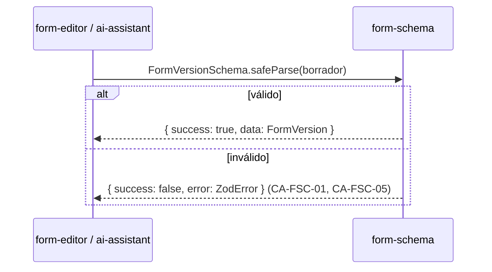
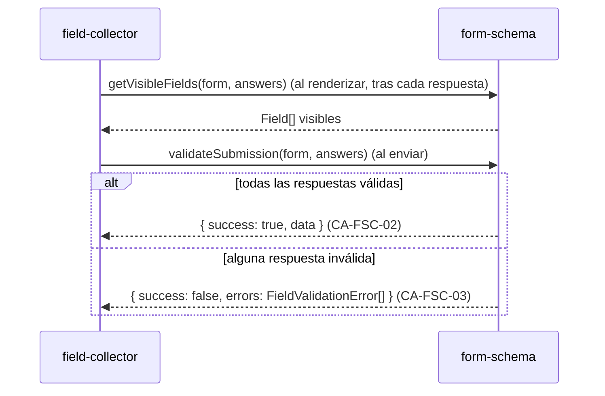

# Esquema del formulario — Diseño técnico

- **Requisitos:** [README.md](README.md)
- **Responsable:** analyst-programmer (escribe), architect (revisa)
- **Issues:** #5

## Resumen

`form-schema` es una librería pura en `src/lib/form-schema` (sin E/S, sin Prisma, sin Next.js): un conjunto de esquemas Zod que describen un `FormVersion` (metadatos, campos ordenados, lógica condicional y una copia mínima del tema) y dos funciones que la usan — `getVisibleFields`/`isFieldVisible` para la lógica condicional y `validateSubmission` para validar las respuestas contra el esquema, ignorando los campos ocultos. El esquema de cada campo se divide en propiedades comunes (`id`, `label`, `description?`, `required`, `visibleIf?`) y una propiedad `config` específica de su `type`, mediante un `z.discriminatedUnion("type", …)`. Todo el módulo se consume por import desde cualquier capa (cliente o servidor) sin ningún efecto secundario.

## Modelo de datos

No aplica: `form-schema` no toca `prisma/schema.prisma` (RNF-FSC-01). Los tipos que define son el contenido de dos columnas JSONB que crearán otros módulos más adelante:

- `FormVersion.schema` (tabla `FormVersion`, la añadirá `form-publishing` o `tenancy-auth`) = `FormVersionSchema`.
- `Submission.answers` (tabla `Submission`, la añadirá `field-collector`/`submissions-dashboard`) = el `data` que devuelve `validateSubmission`.

## Estructura de ficheros

| Capa | Ruta | Responsabilidad |
| --- | --- | --- |
| Lógica pura | `src/lib/form-schema/condition.schema.ts` | `VisibleIfSchema`, `evaluateCondition`, `isAnswered`. Sin dependencias de otros ficheros del módulo. |
| Lógica pura | `src/lib/form-schema/theme.schema.ts` | `ThemeSnapshotSchema`: copia mínima del tema embebida en el `FormVersion`. |
| Esquema | `src/lib/form-schema/field.schema.ts` | `FIELD_TYPES`, `OptionSchema`, `FileRefSchema`, `GpsAnswerSchema`, un `*FieldSchema` por tipo y `FieldSchema` (unión discriminada). Importa `condition.schema.ts`. |
| Esquema | `src/lib/form-schema/answer.schema.ts` | `buildFieldAnswerSchema(field)`: Zod del valor de respuesta de un campo según su `type`/`config`. Importa `field.schema.ts`. |
| Esquema | `src/lib/form-schema/form-version.schema.ts` | `FormVersionSchema`, `FormVersion`, `CURRENT_SCHEMA_VERSION`, refinamiento de integridad (ids duplicados, referencias de `visibleIf`). Importa `field.schema.ts` y `theme.schema.ts`. |
| Lógica pura | `src/lib/form-schema/submission.ts` | `getVisibleFields`, `isFieldVisible`, `validateSubmission`, tipos `FieldValidationError`/`SubmissionValidationResult`. Importa `form-version.schema.ts`, `condition.schema.ts` y `answer.schema.ts`. |
| Fixtures | `src/lib/form-schema/fixtures/demo-forms.ts` | Los tres `FormVersion` de ejemplo de `CLAUDE.md` (parte de obra, encuesta de satisfacción, alta de cliente), usados por CA-FSC-04 y, en el futuro, por `demo-seed`. |
| Barril | `src/lib/form-schema/index.ts` | Reexporta todo lo público del módulo. |

## Contratos

### Funciones y tipos

```ts
// condition.schema.ts
export const CONDITION_OPERATORS = ["equals", "notEquals", "includes", "isAnswered"] as const;
export type ConditionOperator = (typeof CONDITION_OPERATORS)[number];

export const VisibleIfSchema: z.ZodType<VisibleIf>;
export type VisibleIf = { fieldId: string; operator: ConditionOperator; value?: string | number | boolean };
// .superRefine: si operator !== "isAnswered", "value" es obligatorio (si falta, issue en path ["value"]).

export function isAnswered(value: unknown): boolean;
// undefined/null -> false; string vacía (tras trim) -> false; array vacío -> false; resto -> true.

export function evaluateCondition(condition: VisibleIf, answers: Record<string, unknown>): boolean;
// equals: answers[fieldId] === value · notEquals: !== value
// includes: Array.isArray(answers[fieldId]) && answers[fieldId].includes(value)
// isAnswered: isAnswered(answers[fieldId])
```

```ts
// theme.schema.ts
export const ThemeSnapshotSchema: z.ZodType<ThemeSnapshot>;
export type ThemeSnapshot = {
  primaryColor?: string;   // z.string().regex(/^#[0-9a-fA-F]{6}$/)
  secondaryColor?: string; // idem
  fontFamily?: string;
  logoKey?: string;        // referencia de almacenamiento, no URL firmada
};
```

```ts
// field.schema.ts
export const FIELD_TYPES = [
  "text", "number", "date", "datetime", "time",
  "single_choice", "multiple_choice", "yes_no",
  "photo", "signature", "gps", "section",
] as const;
export type FieldType = (typeof FIELD_TYPES)[number];

export const OptionSchema: z.ZodType<Option>;
export type Option = { id: string; label: string }; // RF-FSC-10: id estable, independiente del label

export const FileRefSchema: z.ZodType<FileRef>;
export type FileRef = { key: string; originalName?: string; mimeType?: string; sizeBytes?: number };

export const GpsAnswerSchema: z.ZodType<GpsAnswer>;
// { lat: z.number().min(-90).max(90), lng: z.number().min(-180).max(180),
//   accuracy: z.number().nonnegative(), capturedAt: z.string().datetime() }
export type GpsAnswer = { lat: number; lng: number; accuracy: number; capturedAt: string };

// Propiedades comunes a todo campo (BaseFieldSchema, no exportado):
// { id: string; label: string; description?: string; required: boolean; visibleIf?: VisibleIf }
// + "type" (literal) y "config" (específico del tipo), por cada *FieldSchema:

export const TextFieldSchema: /* type: "text", config: { multiline?, minLength?, maxLength?, placeholder? } */;
export const NumberFieldSchema: /* type: "number", config: { min?, max?, decimals?, unit? } */;
export const DateFieldSchema: /* type: "date", config: { min?, max? } */;        // ISO fecha (z.string().date())
export const DateTimeFieldSchema: /* type: "datetime", config: { min?, max? } */; // ISO datetime (z.string().datetime())
export const TimeFieldSchema: /* type: "time", config: {} */;                    // "HH:mm"
export const SingleChoiceFieldSchema: /* type: "single_choice", config: { options: Option[]; display: "radio" | "dropdown" } */;
export const MultipleChoiceFieldSchema: /* type: "multiple_choice", config: { options: Option[]; minSelected?; maxSelected? } */;
export const YesNoFieldSchema: /* type: "yes_no", config: {} */;
export const PhotoFieldSchema: /* type: "photo", config: { maxPhotos?: number; allowGallery?: boolean } */;
export const SignatureFieldSchema: /* type: "signature", config: {} */;
export const GpsFieldSchema: /* type: "gps", config: { autoCapture?: boolean } */;
export const SectionFieldSchema: /* type: "section", required: literal(false), config: {} */;

export const FieldSchema = z.discriminatedUnion("type", [ /* los 12 anteriores */ ]);
export type Field = z.infer<typeof FieldSchema>;
```

```ts
// answer.schema.ts
export function buildFieldAnswerSchema(field: Field): z.ZodType<unknown>;
// Devuelve el Zod del VALOR de respuesta de ese campo (sin envolver en objeto), construido
// a partir de field.type y field.config:
//  text -> z.string() [+ .min(minLength)/.max(maxLength) si están definidos]
//  number -> z.number() [+ .min(min)/.max(max)]
//  date -> z.string().date().superRefine((value, ctx) => ...): compara `value` con
//          field.config.min/max; los strings ISO-8601 de `date` ordenan igual
//          lexicográfica y cronológicamente, así que basta `value < min` / `value > max`.
//          Mensajes: `La fecha debe ser posterior o igual a "<min>".` /
//          `La fecha debe ser anterior o igual a "<max>".`
//  datetime -> z.string().datetime().superRefine(<mismo refinamiento que date, sobre
//          field.config.min/max, con los mensajes "La fecha y hora debe ser posterior o
//          igual a ..."/"La fecha y hora debe ser anterior o igual a ...">)
//  time -> z.string().regex(/^([01]\d|2[0-3]):[0-5]\d$/)
//  single_choice -> z.string().refine(v => field.config.options.some(o => o.id === v))
//  multiple_choice -> z.array(<option id válido>) [+ .min(minSelected)/.max(maxSelected)]
//  yes_no -> z.boolean()
//  photo -> z.array(FileRefSchema).max(field.config.maxPhotos ?? Infinity)
//  signature -> FileRefSchema
//  gps -> GpsAnswerSchema
//  section -> lanza Error("section no tiene respuesta"); validateSubmission nunca lo llama para este tipo.
```

```ts
// form-version.schema.ts
export const CURRENT_SCHEMA_VERSION = 1;

export const FormVersionSchema = z.object({
  schemaVersion: z.literal(CURRENT_SCHEMA_VERSION), // RF-FSC-08 (migraciones) se deja para cuando se diseñe
  title: z.string().min(1).max(200),
  description: z.string().max(2000).optional(),
  theme: ThemeSnapshotSchema.optional(),
  fields: z.array(FieldSchema).min(1),
}).superRefine(validateFieldIntegrity);
export type FormVersion = z.infer<typeof FormVersionSchema>;

// validateFieldIntegrity (no exportado), recorre `fields` dos veces:
// 1) ids duplicados -> issue en path ["fields", index, "id"], mensaje: `Id de campo duplicado: "<id>".`
// 2) por cada field.visibleIf:
//    - fieldId no existe entre los ids ya vistos -> issue en ["fields", index, "visibleIf", "fieldId"],
//      mensaje: `"<fieldId>" no existe.`
//    - fieldId existe pero su índice >= índice del campo actual (posterior o el propio campo,
//      lo que también cubre cualquier referencia circular, porque sólo se permite apuntar a un
//      campo estrictamente anterior) -> mismo path, mensaje:
//      `"<fieldId>" es posterior o es el propio campo (referencia circular no permitida).`
```

```ts
// submission.ts
export type FieldValidationError = { fieldId: string; message: string };
export type SubmissionValidationResult =
  | { success: true; data: Record<string, unknown> }
  | { success: false; errors: FieldValidationError[] };

export function isFieldVisible(field: Field, answers: Record<string, unknown>): boolean;
// !field.visibleIf -> true; si no, evaluateCondition(field.visibleIf, answers)

export function getVisibleFields(form: FormVersion, answers: Record<string, unknown>): Field[];
// form.fields.filter(f => isFieldVisible(f, answers))

export function validateSubmission(
  form: FormVersion,
  answers: Record<string, unknown>,
): SubmissionValidationResult;
// Recorre form.fields en orden; por cada campo:
//  - type === "section" -> se ignora (sin respuesta).
//  - !isFieldVisible(field, answers) -> se ignora, aunque answers[field.id] venga informado (RF-FSC-06, CA-FSC-02).
//  - !isAnswered(answers[field.id]):
//      - field.required -> error { fieldId, message: `"<label>" es obligatorio.` }
//      - si no, se ignora.
//  - en otro caso -> buildFieldAnswerSchema(field).safeParse(answers[field.id]):
//      - éxito -> data[field.id] = result.data
//      - fallo -> error { fieldId, message: <issues.map(i => i.message).join("; ")> } (CA-FSC-03)
// Devuelve { success: false, errors } si errors.length > 0; si no, { success: true, data }.
```

```ts
// fixtures/demo-forms.ts
export const dailyConstructionReportForm: FormVersion;   // parte diario de obra: fotos, firma, GPS
export const customerSatisfactionSurveyForm: FormVersion; // encuesta de satisfacción
export const clientOnboardingForm: FormVersion;            // alta de cliente para gestoría
export const demoForms: readonly FormVersion[]; // los tres anteriores, para iterar en el test de CA-FSC-04
```

```ts
// index.ts — reexporta todo lo anterior (tipos y valores) para que el resto de módulos
// importen siempre desde "@/lib/form-schema", nunca de un fichero interno.
```

## Flujos





## Errores

No aplica una tabla HTTP: el módulo no tiene entrada HTTP (RNF-FSC-01). Lo que expone son resultados de validación, que consume el módulo que sí tenga interfaz o API:

| Escenario | Qué devuelve `form-schema` | Quién lo traduce a HTTP/UI |
| --- | --- | --- |
| `FormVersion` inválido (ids duplicados, `visibleIf` inválido, tipo de campo mal formado…) | `FormVersionSchema.safeParse(...)` → `{ success: false, error: ZodError }` | `form-editor`/`ai-assistant`: 400 con los `issues` mapeados a sus campos del formulario |
| Respuesta inválida o campo obligatorio sin responder | `validateSubmission(...)` → `{ success: false, errors: FieldValidationError[] }` | `field-collector`: resalta el campo en el formulario; `submissions-dashboard`/`public-api`: 400 si llega una respuesta inválida por API |

## Seguridad y privacidad

- Sin E/S ni persistencia: no hay rol ni `organizationId` que filtrar en este módulo.
- `FileRefSchema` solo admite la referencia de almacenamiento (`key`) y metadatos; nunca una URL firmada ni el contenido del archivo, para no filtrar datos en un esquema que viaja entero al cliente (editor, IA).
- Los *fixtures* de `fixtures/demo-forms.ts` no contienen ningún dato personal real (son formularios vacíos, sin respuestas).
- Ningún `console.log`/log de las respuestas: este módulo no registra nada; lo recuerda `CLAUDE.md` para los módulos que sí hacen E/S.

## Tests

| Criterio / Requisito | Tipo | Fichero |
| --- | --- | --- |
| RF-FSC-01, RF-FSC-03, RF-FSC-04, RF-FSC-10 | Vitest | `src/lib/form-schema/field.schema.test.ts` |
| CA-FSC-08 | Vitest | `src/lib/form-schema/field.schema.test.ts` |
| RF-FSC-05 | Vitest | `src/lib/form-schema/condition.schema.test.ts` |
| CA-FSC-06, CA-FSC-07 | Vitest | `src/lib/form-schema/condition.schema.test.ts` |
| CA-FSC-01 | Vitest | `src/lib/form-schema/form-version.schema.test.ts` |
| CA-FSC-05, RF-FSC-07, RF-FSC-02 | Vitest | `src/lib/form-schema/form-version.schema.test.ts` |
| RF-FSC-06 | Vitest | `src/lib/form-schema/submission.test.ts` |
| CA-FSC-02 | Vitest | `src/lib/form-schema/submission.test.ts` |
| CA-FSC-03 | Vitest | `src/lib/form-schema/submission.test.ts` |
| CA-FSC-04 | Vitest | `src/lib/form-schema/fixtures/demo-forms.test.ts` |
| RF-FSC-03 (límites `min`/`max` de `date` y `datetime`) | Vitest | `src/lib/form-schema/answer.schema.test.ts` |

Cada `it(...)` que cubra un criterio de aceptación incluye el identificador literal en el título (por ejemplo `it("CA-FSC-01 — rechaza ids de campo duplicados", ...)`), para poder filtrarlo con `vitest run <fichero> -t "CA-FSC-01"` desde `test-plan.md`. La fila de `RF-FSC-03` no tiene un `CA-FSC` propio (no lo pedía el issue); no lleva caso dedicado en `test-plan.md` y queda cubierta por `PP-FSC-G3` (`npm test`) y por el umbral de cobertura (`PP-FSC-G6`, ver abajo).

### Cobertura (RNF-FSC-02)

Para que el umbral de cobertura se compruebe solo, sin revisión manual, el desarrollador añade:

- **devDependency** `@vitest/coverage-v8` (misma rama mayor que `vitest`, hoy `^5`): es el proveedor de cobertura estándar de Vitest, ya implícito en el stack de `CLAUDE.md` (no es una dependencia nueva de funcionalidad, solo el motor de cobertura del test runner que ya se usa).
- En `vitest.config.ts`, dentro de `test`, el bloque:
  ```ts
  coverage: {
    provider: "v8",
    include: ["src/lib/form-schema/**"],
    thresholds: {
      lines: 90,
      statements: 90,
      branches: 90,
      functions: 90,
    },
  },
  ```
  `include` se limita a `src/lib/form-schema/**` porque es el único módulo con código fuente por ahora; cuando otro módulo necesite medir su propia cobertura, su analista ampliará `include` o moverá el umbral a una configuración por módulo (riesgo anotado en "Supuestos y preguntas abiertas" del README).
- Con esto, `npx vitest run --coverage` (caso general `PP-FSC-G6` del plan de pruebas) termina con código ≠0 si alguna de las cuatro métricas no llega al 90 % en `src/lib/form-schema`.

## Tareas de desarrollo

| Orden | Issue | Tarea | Depende de |
| --- | --- | --- | --- |
| 1 | #5 | `condition.schema.ts` + test (`VisibleIfSchema`, `isAnswered`, `evaluateCondition`) | — |
| 2 | #5 | `theme.schema.ts` + test (`ThemeSnapshotSchema`) | — |
| 3 | #5 | `field.schema.ts` + test (tipos de campo, `FieldSchema`) | 1 |
| 4 | #5 | `answer.schema.ts` + test (`buildFieldAnswerSchema`) | 3 |
| 5 | #5 | `form-version.schema.ts` + test (`FormVersionSchema`, integridad) | 3 |
| 6 | #5 | `submission.ts` + test (`getVisibleFields`, `isFieldVisible`, `validateSubmission`) | 1, 4, 5 |
| 7 | #5 | `fixtures/demo-forms.ts` + test (los tres formularios de la demo) | 5 |
| 8 | #5 | `index.ts` (barril de exportación) | 1-7 |
| 9 | #5 | Añadir devDependency `@vitest/coverage-v8` y los `thresholds` en `vitest.config.ts` (RNF-FSC-02); comprobar `npx vitest run --coverage` en verde | 1-8 |

## Historial de cambios

- 2026-11-17 — Diseño inicial (#5).
- 2026-11-17 — Revisión del arquitecto aplicada (#5): umbral de cobertura de RNF-FSC-02 automatizado con `@vitest/coverage-v8` y `thresholds` en `vitest.config.ts` (sustituye la comprobación manual); contrato exacto del límite `min`/`max` de `date`/`datetime` en `buildFieldAnswerSchema` (comparación lexicográfica de strings ISO-8601); validadores exactos de `GpsAnswerSchema`.
