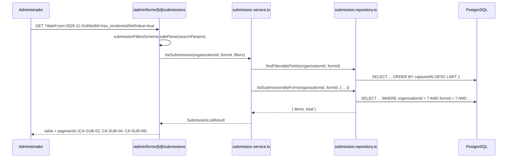
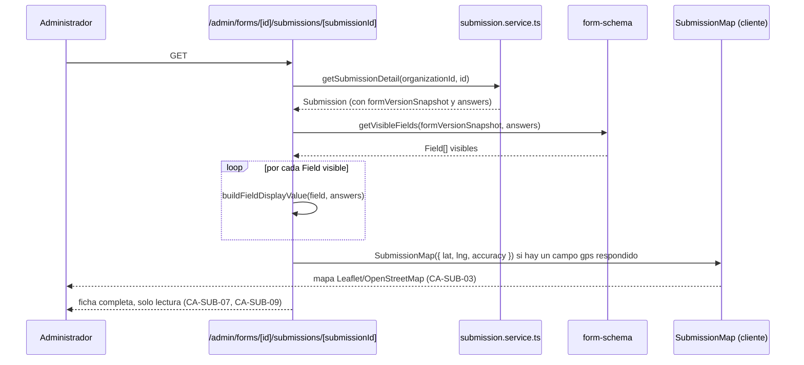

# Respuestas y panel — Diseño técnico

- **Requisitos:** [README.md](README.md)
- **Responsable:** analyst-programmer (escribe), architect (revisa)
- **Issues:** #7 (diseño), padre #1

## Resumen

El issue #7 construye solo la mitad de **solo lectura** del módulo: listado paginado y filtrable de respuestas por formulario, ficha de detalle, y un panel de inicio con contadores. La recepción real desde la PWA (RF-SUB-01 a RF-SUB-04) y el disparo de salidas (RF-SUB-09) quedan fuera porque dependen de `form-publishing` (estados `draft`/`published` y `FormVersion`) y `file-storage` (fotos y firma reales), ninguno con issue propio todavía — se recomienda abrirlos como siguiente paso (ver "Riesgos y recomendaciones" más abajo).

Dos decisiones de acoplamiento, explicadas en detalle en "Modelo de datos":

1. **`Submission` no tiene clave foránea a `Form`** (de `form-editor`, #6) **ni a `FormVersion`** (de `form-publishing`, sin issue). El issue #7 depende solo de `tenancy-auth` (#4) y `form-schema` (#5), igual que indica su propia descripción; `form-editor`/`form-publishing` son módulos distintos que se fusionan de forma independiente (regla de `merge` por `module:<modulo>`), así que `submissions-dashboard` no puede exigir que su tabla exista en un orden concreto. `Submission.formId` es un identificador lógico de texto; `Submission.formTitle` guarda una copia de su nombre para no tener que unir con otra tabla. Cuando se diseñe `form-publishing`, decidirá si convierte `formId` en una clave foránea real (migración futura, fuera de este issue).
2. **Cada `Submission` guarda su propia copia inmutable del esquema** (`formVersionSnapshot`, con la forma de `FormVersion` de `form-schema`) en vez de apuntar a una fila de `FormVersion` que todavía no existe (RF-SUB-11). Esto ya es, además, el comportamiento que pedirá `CA-PUB-01` en el futuro ("las respuestas antiguas siguen mostrando las etiquetas de v1"): la ficha de detalle nunca tiene que mirar el formulario actual para saber qué etiquetas mostrar.

El resto del módulo es solo lectura: dos páginas (listado y ficha), ambas Server Components protegidos con `requireAdminPage()` de `tenancy-auth`, sin ninguna `server action` (no hay ninguna mutación en el alcance de #7) y sin ningún route handler propio. Los filtros del listado se mandan por querystring con un `<form method="get">` normal, así que no hace falta JavaScript en el cliente para aplicarlos. El mapa de la ficha de detalle es el único componente de cliente, por el límite de `react-leaflet` con `window`.

## Modelo de datos

```prisma
// prisma/schema.prisma — se añade este bloque

model Submission {
  id                  String   @id @default(cuid())
  organizationId      String
  formId              String   // identificador lógico del formulario; SIN relación de Prisma (ver Resumen, decisión 1)
  formTitle           String   // copia del nombre del formulario en el momento de la respuesta, para listar sin depender de otra tabla
  clientId            String   // UUID generado en el dispositivo; preparado para RF-SUB-02 (idempotencia), que no se implementa en #7
  formVersionSnapshot Json     // FormVersion (form-schema), copia inmutable con la que se rellenó (RF-SUB-11)
  answers             Json     // Record<string, unknown>, mismo contenido que validateSubmission(...).data de form-schema
  submittedByName     String?  // texto libre; sin relación con User de tenancy-auth (la recepción real que la rellenará es de #RF-SUB-01..04, fuera de #7)
  capturedAt          DateTime // fecha de la respuesta en el dispositivo
  syncedAt            DateTime @default(now()) // fecha en el servidor
  createdAt           DateTime @default(now())

  organization Organization @relation(fields: [organizationId], references: [id])

  @@unique([organizationId, clientId])
  @@index([organizationId, formId, capturedAt])
  @@map("submissions")
}
```

```prisma
// prisma/schema.prisma — se modifica el modelo de tenancy-auth (#4) para añadir la relación inversa;
// si #4 ya está fusionado cuando se desarrolle #7, es la única línea que toca un modelo ajeno
// (mismo patrón que usó form-editor, #6, con Organization):
model Organization {
  // ...campos existentes de #4, sin cambios...
  submissions Submission[]
}
```

- Índice `[organizationId, formId, capturedAt]`: cubre el `where` del listado (siempre `organizationId` primero) y el `orderBy: { capturedAt: "desc" }` sin ordenación adicional (RNF-SUB-02).
- `@@unique([organizationId, clientId])`: no se usa activamente en #7 (no hay recepción), pero se define ya porque es un cambio de esquema — si se añadiera después de la implementación de RF-SUB-02 obligaría a otra migración; se deja preparado y documentado como "sin uso todavía" para que `form-publishing`/`field-collector` lo reutilicen directamente.
- `formVersionSnapshot` y `answers` son `Json` (JSONB en PostgreSQL); no se valida en el servidor en #7 (no hay entrada HTTP): los únicos escritores son el seed de pruebas y los tests, que son responsables de guardar datos coherentes con `form-schema`. La validación con `validateSubmission(...)` de `form-schema` es responsabilidad del módulo que reciba respuestas reales (`RF-SUB-03`, fuera de #7).
- Migración: `init_submissions_dashboard` (`npx prisma migrate dev --name init_submissions_dashboard`).

## Estructura de ficheros

| Capa | Ruta | Responsabilidad |
| --- | --- | --- |
| Modelo | `prisma/schema.prisma` (modificar) | `Submission`, relación inversa en `Organization`. |
| Esquema | `src/lib/submissions-dashboard/submission-filters.schema.ts` | `submissionFiltersSchema`, tipo `SubmissionFiltersInput`: parsea el `searchParams` del listado. |
| Lógica pura | `src/lib/submissions-dashboard/field-display.ts` | `buildFieldDisplayValue(field, answers)`: convierte un `Field` + las respuestas en lo que hay que pintar en la ficha. |
| Lógica pura | `src/lib/submissions-dashboard/file-placeholder.ts` | `resolvePlaceholderFileUrl(file, kind)`: URL de marcador de posición mientras no exista `file-storage`. |
| Repositorio | `src/server/submissions/submission.repository.ts` | Consultas Prisma de `Submission`, todas con `organizationId`. |
| Servicio | `src/server/submissions/submission.service.ts` | Reglas de negocio: listar con filtros, detalle, campos filtrables, estadísticas, alta de datos de prueba. |
| Interfaz | `src/app/admin/forms/[id]/submissions/page.tsx` | Listado (Server Component). `[id]` es `Submission.formId` (identificador lógico, ver Resumen). |
| Interfaz | `src/app/admin/forms/[id]/submissions/[submissionId]/page.tsx` | Ficha de detalle (Server Component). |
| Interfaz | `src/app/admin/page.tsx` (modificar) | Panel de inicio (RF-SUB-10): sustituye el placeholder de `tenancy-auth` (#4) por `<SubmissionStats />`. Ver "Preguntas para el arquitecto" en el issue: posible solape con #6. |
| Componentes | `src/components/submissions-dashboard/submissions-table.tsx` | Tabla del listado (fecha, enviado por, enlace a la ficha) y paginación (CA-SUB-04). |
| Componentes | `src/components/submissions-dashboard/submission-filters-bar.tsx` | `<form method="get">` con los filtros (fechas, usuario, campo+valor, texto libre); Server Component, sin JavaScript de cliente. |
| Componentes | `src/components/submissions-dashboard/submission-detail.tsx` | Compone la ficha: recorre `getVisibleFields(...)` y pinta cada campo con `submission-field-value.tsx`. |
| Componentes | `src/components/submissions-dashboard/submission-field-value.tsx` | Renderiza un `FieldDisplayValue` según su `kind` (texto, fotos, firma, gps, sección, vacío). |
| Componentes | `src/components/submissions-dashboard/submission-map.tsx` | `"use client"`; mapa Leaflet de un punto GPS, solo se monta tras `useEffect` (evita el acceso a `window` en el renderizado del servidor). |
| Componentes | `src/components/submissions-dashboard/submission-stats.tsx` | Tarjetas del panel de inicio (hoy, semana, por formulario). |
| Recursos | `public/placeholder-photo.svg`, `public/placeholder-signature.svg` | Imágenes de marcador de posición (ver `file-placeholder.ts`). |
| Datos de prueba | `prisma/fixtures/submissions-dashboard.fixtures.ts` | `buildDailyReportFormVersion()`, `buildSampleSubmissions(organizationId)`: un `FormVersion` mínimo propio (texto, `yes_no` "¿Hay incidencias?", `photo`, `signature`, `gps`) y varias `Submission` de ejemplo, usados por los tests de Vitest/Playwright y, opcionalmente, por `prisma/seed.ts` si ya existe cuando se desarrolle #7. No se usan los *fixtures* de `form-schema` (`dailyConstructionReportForm`, etc.): su contenido exacto todavía no está implementado (#5 sigue en diseño) y este módulo necesita un campo `yes_no` con una etiqueta concreta para CA-SUB-02. |

**Dependencia nueva de npm** (a confirmar por el arquitecto, ver preguntas en el issue): `leaflet`, `react-leaflet` (dependencies) y `@types/leaflet` (devDependency), para el mapa de la ficha de detalle (CA-SUB-03), sin clave de API (OpenStreetMap). Componentes de `shadcn/ui` a añadir si faltan: `table`, `badge`, `card`, `pagination` (o enlaces `<Link>` simples si el proyecto no tiene ese componente todavía — a decidir por el programador si `pagination` no existe en la versión instalada de `shadcn/ui`, usando enlaces `?page=N` simples).

## Contratos

### Funciones y tipos

```ts
// src/lib/submissions-dashboard/submission-filters.schema.ts
import { z } from "zod";

export const submissionFiltersSchema = z.object({
  dateFrom: z.string().date().optional(),   // capturedAt >= este día (00:00 local server)
  dateTo: z.string().date().optional(),     // capturedAt <= este día (23:59:59.999)
  submittedBy: z.string().trim().min(1).optional(), // RF-SUB-06, coincidencia parcial sin distinguir mayúsculas
  fieldId: z.string().min(1).optional(),    // id de un campo single_choice o yes_no del formVersionSnapshot
  fieldValue: z.string().min(1).optional(), // "true"/"false" para yes_no, id de opción para single_choice
  q: z.string().trim().min(1).optional(),   // RF-SUB-07, búsqueda libre
  page: z.coerce.number().int().positive().default(1),
});
export type SubmissionFiltersInput = z.infer<typeof submissionFiltersSchema>;
export const SUBMISSIONS_PAGE_SIZE = 20; // RF-SUB-05, CA-SUB-04
```

```ts
// src/lib/submissions-dashboard/field-display.ts
import type { Field, FileRef, GpsAnswer } from "@/lib/form-schema";

export type FieldDisplayValue =
  | { kind: "section"; title: string; description?: string }
  | { kind: "empty" }                                   // visible pero sin respuesta (campo opcional)
  | { kind: "text"; text: string }                       // text, number, date, datetime, time, single_choice, multiple_choice, yes_no
  | { kind: "photos"; files: FileRef[] }
  | { kind: "signature"; file: FileRef }
  | { kind: "gps"; value: GpsAnswer };

/** No tiene E/S. Traduce `field.type` + `answers[field.id]` a algo que pintar:
 *  - "section" -> { kind: "section", title: field.label, description: field.description }
 *  - sin responder (answers[field.id] es undefined/null) -> { kind: "empty" }
 *  - single_choice -> busca la label de la opción en field.config.options; si no la encuentra, usa el id crudo
 *  - multiple_choice -> las labels de las opciones seleccionadas, unidas con ", "
 *  - yes_no -> "Sí" / "No"
 *  - text/number/date/datetime/time -> String(value)
 *  - photo -> { kind: "photos", files: value as FileRef[] }
 *  - signature -> { kind: "signature", file: value as FileRef }
 *  - gps -> { kind: "gps", value: value as GpsAnswer } */
export function buildFieldDisplayValue(
  field: Field,
  answers: Record<string, unknown>,
): FieldDisplayValue;
```

```ts
// src/lib/submissions-dashboard/file-placeholder.ts
import type { FileRef } from "@/lib/form-schema";

// TODO(file-storage, RF-STO-02): sustituir por una URL firmada real cuando exista el módulo.
export function resolvePlaceholderFileUrl(file: FileRef, kind: "photo" | "signature"): string;
// Devuelve "/placeholder-photo.svg" o "/placeholder-signature.svg"; no usa `file.key` todavía
// (no hay almacenamiento real), pero mantiene la firma con `file` para no tener que cambiarla
// cuando exista `file-storage`.
```

```ts
// src/server/submissions/submission.repository.ts
import type { Submission } from "@prisma/client";
import type { FormVersion } from "@/lib/form-schema";

export type SubmissionListFilters = {
  dateFrom?: Date;
  dateTo?: Date;
  submittedBy?: string;
  fieldFilter?: { fieldId: string; value: string | boolean };
  textQuery?: string;
  page: number;
};

export type SubmissionListItem = {
  id: string;
  capturedAt: Date;
  syncedAt: Date;
  submittedByName: string | null;
};

export type SubmissionStats = {
  today: number;
  thisWeek: number;
  byForm: Array<{ formId: string; formTitle: string; count: number }>;
};

/** `where` siempre incluye `{ organizationId, formId }`. Si `filters.textQuery` está
 *  informado, antes hace una consulta SQL cruda (ver más abajo) para resolver los `id`
 *  candidatos y añade `id: { in: candidateIds }`; si no hay ninguno, devuelve
 *  `{ items: [], total: 0 }` sin llegar a hacer la consulta principal.
 *  `orderBy: { capturedAt: "desc" }`, `skip`/`take` con SUBMISSIONS_PAGE_SIZE (CA-SUB-04). */
export function listSubmissionsByForm(
  organizationId: string,
  formId: string,
  filters: SubmissionListFilters,
): Promise<{ items: SubmissionListItem[]; total: number }>;

export function findSubmissionById(organizationId: string, id: string): Promise<Submission | null>;

/** Busca las últimas N (p. ej. 20) respuestas de ese formId y, de la más reciente,
 *  devuelve los campos `single_choice`/`yes_no` de su `formVersionSnapshot.fields`
 *  (RF-SUB-06); `[]` si no hay ninguna respuesta todavía. */
export function findFilterableFields(organizationId: string, formId: string): Promise<Field[]>;

export function getSubmissionStats(organizationId: string): Promise<SubmissionStats>;
// today: capturedAt >= inicio del día actual (hora del servidor, suficiente para el piloto)
// thisWeek: capturedAt >= lunes de esta semana
// byForm: GROUP BY formId, formTitle (groupBy de Prisma), count() por grupo, orderBy count desc

/** Única función de escritura del módulo en #7: la usan solo los tests y, si existe ya,
 *  `prisma/seed.ts`. No valida `answers` contra `formVersionSnapshot` (responsabilidad de
 *  la recepción real, fuera de alcance, RF-SUB-03). */
export function createSubmissionFixture(
  organizationId: string,
  data: {
    formId: string;
    formTitle: string;
    clientId: string;
    formVersionSnapshot: FormVersion;
    answers: Record<string, unknown>;
    submittedByName?: string;
    capturedAt: Date;
  },
): Promise<Submission>;
```

```ts
// src/server/submissions/submission.repository.ts (consulta cruda de RF-SUB-07)
import { Prisma } from "@prisma/client";

/** `answers::text ILIKE '%query%'`, siempre con organizationId y formId en el WHERE
 *  (parametrizado con Prisma.sql, nunca concatenado). Devuelve solo los `id`. */
async function findSubmissionIdsByText(
  organizationId: string,
  formId: string,
  query: string,
): Promise<string[]>;
```

```ts
// src/server/submissions/submission.service.ts
import { NotFoundError } from "@/lib/errors"; // de tenancy-auth (#4)
import type { SubmissionFiltersInput } from "@/lib/submissions-dashboard/submission-filters.schema";

export type SubmissionListResult = {
  items: SubmissionListItem[];
  total: number;
  page: number;
  pageSize: number;
  filterableFields: Field[]; // para pintar las opciones del formulario de filtros
};

/** Traduce `SubmissionFiltersInput` (querystring ya parseado) a `SubmissionListFilters`:
 *  - dateFrom/dateTo -> Date a medianoche local / fin de día.
 *  - fieldId + fieldValue -> busca el campo en `findFilterableFields`; si es "yes_no",
 *    `fieldValue === "true"`; si no existe ese campo, se ignora el filtro (sin error:
 *    pudo cambiar de formulario entre peticiones). */
export async function listSubmissions(
  organizationId: string,
  formId: string,
  input: SubmissionFiltersInput,
): Promise<SubmissionListResult>;

/** NotFoundError si `id` no existe en `organizationId` (-> notFound() en la página). */
export async function getSubmissionDetail(
  organizationId: string,
  id: string,
): Promise<Submission>;

export async function getHomeStats(organizationId: string): Promise<SubmissionStats>;
```

### Páginas

| Ruta | Tipo | Responsabilidad |
| --- | --- | --- |
| `/admin/forms/[id]/submissions` | Server Component | `requireAdminPage()`; parsea `searchParams` con `submissionFiltersSchema`; `submissionService.listSubmissions(organizationId, params.id, filters)`; `<SubmissionFiltersBar .../>` + `<SubmissionsTable .../>`. |
| `/admin/forms/[id]/submissions/[submissionId]` | Server Component | `requireAdminPage()`; `submissionService.getSubmissionDetail` o `notFound()`; `<SubmissionDetail submission={...} />`. |
| `/admin` (modificar) | Server Component | `requireAdminPage()`; `submissionService.getHomeStats(organizationId)`; `<SubmissionStats stats={...} />` (RF-SUB-10, CA-SUB-06). |

## Flujos





## Errores

| Error de dominio | HTTP / página | Mensaje en la interfaz |
| --- | --- | --- |
| `UnauthorizedError` (de `requireSession`) | — | Redirige a `/login` (vía `requireAdminPage`). |
| `ForbiddenError` | — | Redirige a `/collect` (rol `collector` en `/admin`). |
| `NotFoundError` (respuesta inexistente o de otra organización) | 404 / `notFound()` | "No se ha encontrado la respuesta." |
| Formulario sin respuestas todavía (`formId` sin ninguna fila) | 200 | No es un error: listado vacío, "No hay respuestas para este formulario todavía.", sin filtros de campo disponibles. |

## Seguridad y privacidad

- Todas las consultas de `submission.repository.ts` llevan `organizationId` en el `WHERE` (también la consulta cruda de texto libre, con `Prisma.sql` parametrizado, nunca concatenación de strings).
- `/admin/forms/**` y `/admin` ya están bajo el `matcher` de `middleware.ts` de `tenancy-auth`; este módulo no añade protección propia.
- `answers` y `formVersionSnapshot` contienen datos personales de la organización (nombres, fotos, firma, GPS): ningún log de este módulo imprime su contenido, solo `id`/`formId` (RNF-SUB-03, igual que `form-schema` con `FormVersion` y `form-editor` con `Form.draftSchema`).
- Las fotos y la firma se muestran con un marcador de posición fijo (`resolvePlaceholderFileUrl`), nunca con una URL real sin firmar: no hay ningún archivo real que proteger todavía en #7, pero se deja la función ya separada para que `file-storage` solo tenga que cambiar su implementación.
- El mapa usa los *tiles* públicos de OpenStreetMap (`https://{s}.tile.openstreetmap.org`) sin clave de API ni cookies de terceros.

## Tests

| Criterio / Requisito | Tipo | Fichero |
| --- | --- | --- |
| RF-SUB-11 | Vitest | `src/server/submissions/submission.repository.test.ts` — `createSubmissionFixture` guarda `formVersionSnapshot` tal cual, sin mutarlo. |
| — (filtro por organización) | Vitest | `src/server/submissions/submission.repository.test.ts` — `findSubmissionById`/`listSubmissionsByForm` con el `organizationId` de otra organización no devuelven las respuestas de la primera. |
| CA-SUB-04 | Vitest | `src/server/submissions/submission.repository.test.ts` — con 25 respuestas creadas, la página 1 devuelve 20 y `total: 25`; la página 2 devuelve las 5 restantes. |
| CA-SUB-02 | Vitest | `src/server/submissions/submission.service.test.ts` — filtro `fieldId`/`fieldValue` sobre el campo `yes_no` "¿Hay incidencias?" de la fixture. |
| CA-SUB-08 | Vitest | `src/server/submissions/submission.service.test.ts` — filtro combinado de rango de fechas y `submittedBy`. |
| CA-SUB-05 | Vitest | `src/server/submissions/submission.repository.test.ts` — `findSubmissionIdsByText`/`listSubmissionsByForm` con `textQuery` encuentra una respuesta por una palabra de un campo de texto, sin distinguir mayúsculas. |
| CA-SUB-06 | Vitest | `src/server/submissions/submission.repository.test.ts` — `getSubmissionStats` con respuestas de hoy, de otro día de esta semana y de la semana pasada. |
| RF-SUB-06 (campos filtrables) | Vitest | `src/server/submissions/submission.repository.test.ts` — `findFilterableFields` devuelve los campos `single_choice`/`yes_no` de la respuesta más reciente; `[]` si no hay ninguna. |
| — (`buildFieldDisplayValue`) | Vitest | `src/lib/submissions-dashboard/field-display.test.ts` — un caso por cada `FieldType` de la fixture (texto, `yes_no`, `photo`, `signature`, `gps`, `section`, y un campo opcional sin responder -> `{ kind: "empty" }`). |
| CA-SUB-09 | Playwright | `e2e/submissions-dashboard-detail.spec.ts` — la ficha muestra las miniaturas de las fotos, la firma, y que al pulsar una miniatura se abre la imagen a tamaño completo. |
| CA-SUB-03 | Playwright | `e2e/submissions-dashboard-detail.spec.ts` — la ficha de una respuesta con GPS muestra el contenedor del mapa (`[data-testid="submission-map"]`) con un marcador. |
| CA-SUB-07 | Playwright | `e2e/submissions-dashboard-detail.spec.ts` — la ficha no contiene ningún campo editable ni botón de guardar/editar. |
| CA-SUB-04, CA-SUB-02 | Playwright | `e2e/submissions-dashboard-listing.spec.ts` — recorrido completo: abrir el listado, aplicar el filtro "¿Hay incidencias? = Sí", cambiar de página, abrir una respuesta desde la tabla. |
| CA-SUB-06 | Playwright | `e2e/submissions-dashboard-home.spec.ts` — `/admin` muestra los contadores con los datos de la fixture. |

### RNF-SUB-02 (rendimiento con 10 000 respuestas)

No se automatiza en #7: generar 10 000 filas realistas y medir el tiempo de carga en el runner de `testPR` es un test de carga, no un test funcional, y el runner no tiene datos de ese volumen (`demo-seed`, sin issue todavía, es quien preparará datos de la demo a mayor escala). Queda en "Comprobaciones manuales" de `test-plan.md` como riesgo anotado, no como caso automático; se recomienda un test de carga específico cuando exista `demo-seed` con datos a esa escala.

## Tareas de desarrollo

| Orden | Issue | Tarea | Depende de |
| --- | --- | --- | --- |
| 1 | #7 | `prisma/schema.prisma` (`Submission`, relación en `Organization`) y migración `init_submissions_dashboard` | — |
| 2 | #7 | Añadir `leaflet`, `react-leaflet`, `@types/leaflet` | — |
| 3 | #7 | `src/lib/submissions-dashboard/submission-filters.schema.ts` + test | — |
| 4 | #7 | `src/lib/submissions-dashboard/field-display.ts` + test | — |
| 5 | #7 | `src/lib/submissions-dashboard/file-placeholder.ts`; `public/placeholder-photo.svg`, `public/placeholder-signature.svg` | — |
| 6 | #7 | `prisma/fixtures/submissions-dashboard.fixtures.ts` | 4 |
| 7 | #7 | `src/server/submissions/submission.repository.ts` + test (depende de 1, 6) | 1, 6 |
| 8 | #7 | `src/server/submissions/submission.service.ts` + test | 3, 7 |
| 9 | #7 | Componentes `shadcn/ui` que falten (`table`, `badge`, `card`) | — |
| 10 | #7 | `src/components/submissions-dashboard/submission-map.tsx` | 2 |
| 11 | #7 | `src/components/submissions-dashboard/submission-field-value.tsx`, `submission-detail.tsx` | 4, 5, 10 |
| 12 | #7 | `src/components/submissions-dashboard/submissions-table.tsx`, `submission-filters-bar.tsx` | 8, 9 |
| 13 | #7 | `src/components/submissions-dashboard/submission-stats.tsx` | 8 |
| 14 | #7 | `src/app/admin/forms/[id]/submissions/page.tsx`, `.../[submissionId]/page.tsx` | 8, 11, 12 |
| 15 | #7 | `src/app/admin/page.tsx` (modificar) | 8, 13 |
| 16 | #7 | `e2e/submissions-dashboard-listing.spec.ts`, `-detail.spec.ts`, `-home.spec.ts` | 14, 15 |

## Historial de cambios

- 2026-11-18 — Diseño inicial (#7): `Submission` sin clave foránea a `Form`/`FormVersion` (identificador lógico `formId` + copia inmutable del esquema en `formVersionSnapshot`, RF-SUB-11); listado paginado y filtrable, ficha de detalle solo lectura y panel de inicio, todos como Server Components sin ninguna mutación; mapa con `leaflet`/`react-leaflet` (dependencia nueva, pendiente de aprobación); marcador de posición para fotos/firma mientras no exista `file-storage`; RNF-SUB-02 fuera del plan de pruebas automático (riesgo anotado).
