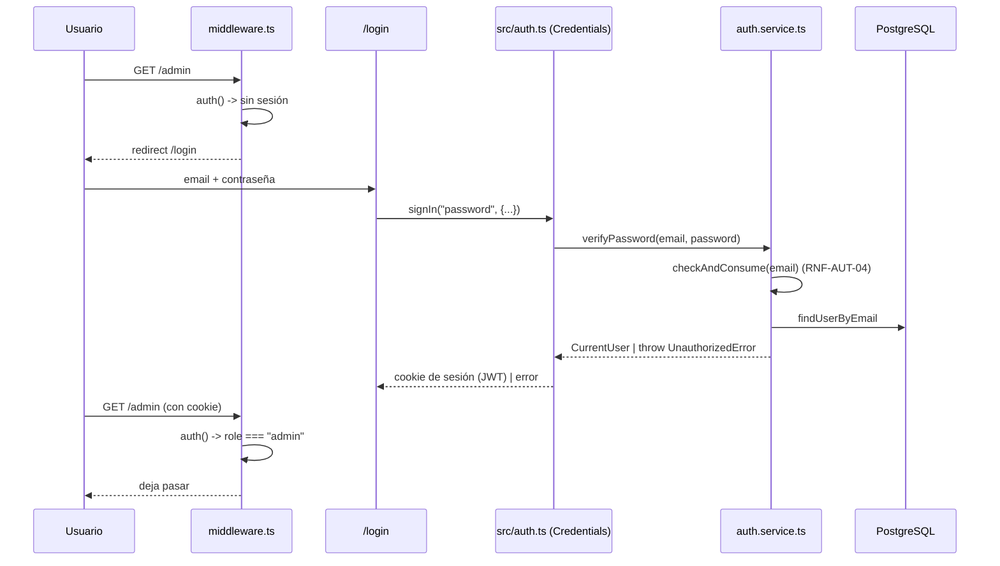
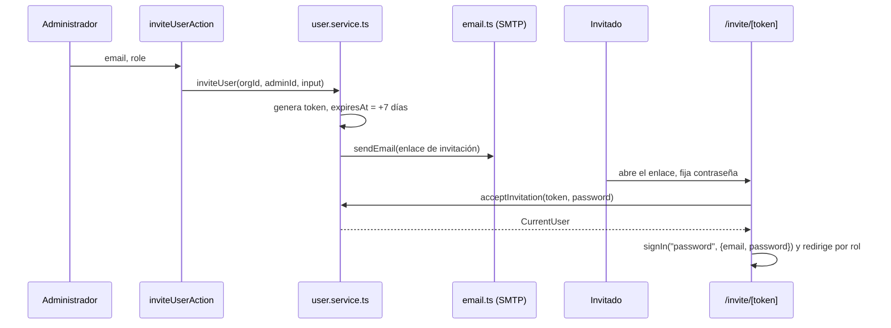

# Organizaciones, usuarios y autenticación — Diseño técnico

- **Requisitos:** [README.md](README.md)
- **Responsable:** analyst-programmer (escribe), architect (revisa)
- **Issues:** #4 (diseño), padre #1

## Resumen

Se usa Auth.js v5 (`next-auth`) con estrategia de sesión **JWT** (cookie `httpOnly`/`secure`/`sameSite`, sin tablas `Account`/`Session` de adaptador: no hace falta porque no hay proveedores OAuth). Dos proveedores `Credentials`:

- `password` — email + contraseña, verificada contra `User.passwordHash` (bcrypt).
- `magic-link` — un token de un solo uso (`LoginToken`) que se genera al pedir el enlace y se verifica al abrirlo; mismo mecanismo de sesión que el login con contraseña, sin tablas de verificación propias de proveedores OAuth/Email de Auth.js.

`Organization` y `User` (con `role: admin | collector`) son las primeras entidades de negocio del proyecto (primera migración real tras el esqueleto vacío de `platform`). No hay alta de organizaciones desde la interfaz en el piloto: las crea el seed; los usuarios nuevos entran siempre por invitación (`Invitation`) o ya existen en el seed.

Un único módulo de servidor, `src/server/auth/session.ts`, expone `requireSession`/`getCurrentOrg`: todos los demás módulos lo importan para no repetir el filtro por `organizationId` ni la comprobación de rol (RNF-AUT-02). Un `middleware.ts` en la raíz protege `/admin/**` (solo `admin`) y `/collect/**` (cualquier sesión); las rutas `/f/**` (relleno público de formularios, que añadirá `field-collector`/`form-publishing`) no están en el `matcher` del middleware, así que nunca pasan por el guardián de sesión — es la parte de infraestructura de RF-AUT-08.

El envío de email (enlace mágico e invitaciones) usa un adaptador SMTP genérico (`nodemailer`, contra Mailpit en local) en `src/server/integrations/email.ts`, reutilizable por otros módulos (por ejemplo `outputs`). Se introduce también `src/lib/errors.ts` con las clases de error de dominio (`NotFoundError`, `ForbiddenError`, `UnauthorizedError`, `ConflictError`, `ValidationError`, `RateLimitError`), que no existían todavía y que reutilizarán los módulos siguientes.

**Decisión explícita para `field-collector`/`form-publishing` (pregunta abierta resuelta, ver README):** un `collector` tiene cuenta y usa `/collect` (protegido por sesión); un formulario publicado puede además marcarse público y rellenarse sin sesión en `/f/[slug]`. El campo "público/restringido" en sí lo añade `form-publishing` sobre `Form`; este módulo ya deja la ruta `/f/**` fuera del guardián para que esa variante funcione sin tocar el middleware otra vez.

## Modelo de datos

```prisma
// prisma/schema.prisma — se añaden estos bloques (primera migración de negocio)

enum Role {
  admin
  collector
}

enum UserStatus {
  active
  inactive
}

model Organization {
  id        String   @id @default(cuid())
  name      String
  createdAt DateTime @default(now())
  updatedAt DateTime @updatedAt

  users       User[]
  invitations Invitation[]

  @@map("organizations")
}

model User {
  id             String     @id @default(cuid())
  organizationId String
  email          String     @unique
  name           String
  passwordHash   String
  role           Role
  status         UserStatus @default(active)
  createdAt      DateTime   @default(now())
  updatedAt      DateTime   @updatedAt

  organization Organization @relation(fields: [organizationId], references: [id])
  loginTokens  LoginToken[]

  @@index([organizationId])
  @@map("users")
}

model Invitation {
  id              String    @id @default(cuid())
  organizationId  String
  email           String
  role            Role
  token           String    @unique
  invitedByUserId String
  expiresAt       DateTime
  acceptedAt      DateTime?
  createdAt       DateTime  @default(now())

  organization Organization @relation(fields: [organizationId], references: [id])

  @@index([organizationId])
  @@map("invitations")
}

model LoginToken {
  id        String    @id @default(cuid())
  userId    String
  token     String    @unique
  expiresAt DateTime
  usedAt    DateTime?
  createdAt DateTime  @default(now())

  user User @relation(fields: [userId], references: [id])

  @@index([userId])
  @@map("login_tokens")
}
```

- `User.email` es único **globalmente** (no por organización): un email solo puede estar en una organización, como ya fija RF-AUT-03/CLAUDE.md ("un usuario en varias organizaciones" está fuera de alcance), y el login busca por email sin conocer antes la organización.
- `User.passwordHash` no es opcional: todo usuario se crea por invitación (que exige fijar contraseña al aceptar, RF-AUT-01) o por el seed; el enlace mágico es una forma adicional de iniciar sesión para un usuario que ya existe, no un tipo de cuenta distinto.
- Índices: `organizationId` en `User` e `Invitation` (siempre primero en los `where` del repositorio); `token` único en `Invitation` y `LoginToken` para la búsqueda directa.
- Sin tablas `Account`/`Session`/`VerificationToken` de Auth.js: con `session: { strategy: "jwt" }` y proveedores `Credentials`, Auth.js no las necesita.
- Migración: `init_tenancy_auth` (`npx prisma migrate dev --name init_tenancy_auth`).

## Estructura de ficheros

| Capa | Ruta | Responsabilidad |
| --- | --- | --- |
| Modelo | `prisma/schema.prisma` (modificar) | `Organization`, `User`, `Invitation`, `LoginToken`, enums `Role`/`UserStatus`. |
| Entorno | `src/lib/env.ts` (modificar), `.env.example` (modificar) | Añade `AUTH_SECRET`, `AUTH_URL`, `SMTP_HOST`, `SMTP_PORT`, `SMTP_FROM`, `SMTP_USER`, `SMTP_PASSWORD` (ver [Variables de entorno](#variables-de-entorno)). |
| Errores compartidos | `src/lib/errors.ts` | Clases de error de dominio reutilizables por todos los módulos. |
| Esquemas | `src/lib/auth/auth.schema.ts` | Zod: `loginSchema`, `requestMagicLinkSchema`, `inviteUserSchema`, `acceptInvitationSchema`. |
| Repositorio | `src/server/auth/organization.repository.ts` | `createOrganization`, `findOrganizationById`. |
| Repositorio | `src/server/auth/user.repository.ts` | Ver [Contratos](#funciones). Todas las funciones que leen/escriben usuarios de una organización reciben `organizationId`; `findUserByEmail` es la única excepción (necesaria para el login, antes de conocer la organización). |
| Repositorio | `src/server/auth/invitation.repository.ts` | `createInvitation`, `findInvitationByToken`, `markInvitationAccepted`, `listPendingInvitations`. |
| Repositorio | `src/server/auth/login-token.repository.ts` | `createLoginToken`, `findValidLoginToken`, `markLoginTokenUsed`. |
| Servicio | `src/server/auth/auth.service.ts` | `hashPassword`, `verifyPassword`, `requestMagicLink`, `verifyMagicLink`. |
| Servicio | `src/server/auth/user.service.ts` | `inviteUser`, `acceptInvitation`, `listUsers`, `deactivateUser`. |
| Servicio | `src/server/auth/rate-limit.ts` | `checkAndConsume` (límite de intentos en memoria, RNF-AUT-04). |
| Servicio | `src/server/auth/session.ts` | `getCurrentUser`, `requireSession`, `requireAdminPage`, `getCurrentOrg`. **Lo importan todos los módulos siguientes.** |
| Integración | `src/server/integrations/email.ts` | `sendEmail`. Cliente SMTP (nodemailer) genérico. |
| Integración | `src/lib/auth/emails.ts` | `buildMagicLinkEmail`, `buildInvitationEmail` (asunto + HTML + texto, sin E/S). |
| Auth.js | `src/auth.ts` | `NextAuth(...)`: proveedores, callbacks `jwt`/`session`, exporta `handlers`, `auth`, `signIn`, `signOut`. |
| Tipos | `src/types/next-auth.d.ts` | Aumenta `Session.user` con `id`, `organizationId` y `role`, y `User` con `organizationId` y `role`. |
| Entrada | `src/app/api/auth/[...nextauth]/route.ts` | `export const { GET, POST } = handlers`. |
| Entrada | `src/server/auth/auth.actions.ts` | Server actions: `requestMagicLinkAction`. |
| Entrada | `src/server/auth/user.actions.ts` | Server actions: `inviteUserAction`, `deactivateUserAction`, `acceptInvitationAction`. |
| Middleware | `middleware.ts` (raíz) | Guardián de sesión de `/admin/**` y `/collect/**` (RF-AUT-06). |
| Interfaz | `src/app/login/page.tsx`, `src/components/auth/login-form.tsx` | Formulario de login (contraseña o enlace mágico). |
| Interfaz | `src/app/login/magic/page.tsx` | Verifica el token del enlace mágico (`?token=`) y abre sesión. |
| Interfaz | `src/app/invite/[token]/page.tsx`, `src/components/auth/accept-invitation-form.tsx` | Aceptar invitación: fijar contraseña. |
| Interfaz | `src/app/admin/layout.tsx`, `src/app/admin/page.tsx` | Layout protegido y placeholder del panel (el contenido real lo añade `form-editor`, #6). |
| Interfaz | `src/app/admin/users/page.tsx` | Listado de usuarios e invitaciones de la organización, invitar, desactivar. |
| Interfaz | `src/app/collect/page.tsx` | Placeholder de la app de recogida (el contenido real lo añade `field-collector`). |
| Datos de ejemplo | `prisma/seed.ts` (modificar) | Crea la organización de ejemplo, un admin y un collector (sustituye el placeholder de `platform`). Credenciales fijas, ver [Datos de ejemplo (seed)](#datos-de-ejemplo-seed). |

### Datos de ejemplo (seed)

`prisma/seed.ts` crea exactamente estos registros (los consumen PP-AUT-07, PP-AUT-08 y el futuro `demo-seed`; no deben variar entre quien escribe el seed y quien escribe los tests e2e):

| Campo | Admin | Collector |
| --- | --- | --- |
| `Organization.name` | "Constructora Demo" (la misma para ambos) | |
| `email` | `admin@demo.formia.local` | `collector@demo.formia.local` |
| `password` (texto plano, antes de `hashPassword`) | `Demo1234!` | `Demo1234!` |
| `name` | "Admin Demo" | "Collector Demo" |
| `role` | `admin` | `collector` |
| `status` | `active` | `active` |

Convención de nombre adoptada: el código de este módulo vive en `src/server/auth/` (no `src/server/tenancy-auth/`), porque coincide con el fichero raíz idiomático de Auth.js v5 (`src/auth.ts`) y con el nombre corto que van a importar todos los módulos (`@/server/auth/session`). Se señala como decisión a confirmar por el arquitecto (ver preguntas en el issue).

## Contratos

### Variables de entorno

Se añaden a `envSchema` (`src/lib/env.ts`) y a `.env.example`:

```ts
AUTH_SECRET: z.string().min(32),                 // secreto de firma del JWT de sesión
AUTH_URL: z.string().url().default("http://localhost:3000"), // base para enlaces absolutos en emails
SMTP_HOST: z.string().min(1).default("localhost"),
SMTP_PORT: z.coerce.number().int().positive().default(1025), // Mailpit en local
SMTP_FROM: z.string().email().default("no-reply@formia.local"),
SMTP_USER: z.string().optional(),                // vacío = sin autenticación SMTP (Mailpit)
SMTP_PASSWORD: z.string().optional(),
```

`.env.example` documenta `AUTH_SECRET` con un placeholder (`changeme-generate-with-openssl-rand-base64-32`) y el resto con los valores de Mailpit en local.

### Endpoints

| Método | Ruta | Rol | Entrada | Respuestas |
| --- | --- | --- | --- | --- |
| GET/POST | `/api/auth/[...nextauth]` | público | gestionado por Auth.js | gestionadas por Auth.js (login, logout, CSRF); no se añade lógica propia aquí, solo los dos proveedores `Credentials` |

El resto de operaciones (pedir enlace mágico, invitar, aceptar invitación, desactivar) son **server actions**, no rutas HTTP propias:

### Server actions

```ts
// src/server/auth/auth.actions.ts
"use server";
export async function requestMagicLinkAction(
  _prevState: unknown,
  formData: FormData,
): Promise<{ sent: true }>; // siempre `sent: true`: no revela si el email existe (RNF-AUT-02)
```

```ts
// src/server/auth/user.actions.ts
"use server";
export async function inviteUserAction(
  _prevState: { error?: string } | undefined,
  formData: FormData,
): Promise<{ error?: string; invited?: true }>;
// requireSession({ role: "admin" }); valida con inviteUserSchema; llama a userService.inviteUser;
// error de dominio ConflictError -> { error: "Ya hay un usuario con ese email." }

export async function deactivateUserAction(
  _prevState: { error?: string } | undefined,
  formData: FormData,
): Promise<{ error?: string }>;
// requireSession({ role: "admin" }); userService.deactivateUser(organizationId, currentUser.id, userId)

export async function acceptInvitationAction(
  token: string,
  _prevState: { error?: string } | undefined,
  formData: FormData,
): Promise<{ error?: string }>;
// valida con acceptInvitationSchema; llama a userService.acceptInvitation(token, password);
// la propia página, en cliente, hace signIn("password", { email, password, redirect: false })
// tras un resultado sin error, y redirige según el rol devuelto.
```

### Funciones

```ts
// src/lib/errors.ts
export class NotFoundError extends Error {}
export class ForbiddenError extends Error {}
export class UnauthorizedError extends Error {}
export class ConflictError extends Error {}
export class ValidationError extends Error {}
export class RateLimitError extends Error {}
```

```ts
// src/lib/auth/auth.schema.ts
export const loginSchema: z.ZodObject<{ email: z.ZodString; password: z.ZodString }>;
export const requestMagicLinkSchema: z.ZodObject<{ email: z.ZodString }>;
export const inviteUserSchema: z.ZodObject<{
  email: z.ZodString;
  role: z.ZodEnum<["admin", "collector"]>;
}>;
export const acceptInvitationSchema: z.ZodObject<{ password: z.ZodString }>; // mínimo 8 caracteres

export type LoginInput = z.infer<typeof loginSchema>;
export type InviteUserInput = z.infer<typeof inviteUserSchema>;
export type AcceptInvitationInput = z.infer<typeof acceptInvitationSchema>;
```

```ts
// src/server/auth/organization.repository.ts
export function createOrganization(data: { name: string }): Promise<Organization>;
export function findOrganizationById(id: string): Promise<Organization | null>;
```

```ts
// src/server/auth/user.repository.ts
export function findUserByEmail(email: string): Promise<User | null>; // sin organizationId: es anterior a conocer la sesión
export function findUserById(organizationId: string, id: string): Promise<User | null>;
export function listUsersByOrganization(organizationId: string): Promise<User[]>;
export function createUser(
  organizationId: string,
  data: { email: string; name: string; role: Role; passwordHash: string },
): Promise<User>;
export function updateUserStatus(
  organizationId: string,
  id: string,
  status: UserStatus,
): Promise<User | null>; // null si no existe EN ESA organización (CA-AUT-01)
```

```ts
// src/server/auth/invitation.repository.ts
export function createInvitation(
  organizationId: string,
  data: { email: string; role: Role; invitedByUserId: string; token: string; expiresAt: Date },
): Promise<Invitation>;
export function findInvitationByToken(token: string): Promise<Invitation | null>;
export function markInvitationAccepted(id: string): Promise<Invitation>;
export function listPendingInvitations(organizationId: string): Promise<Invitation[]>;
```

```ts
// src/server/auth/login-token.repository.ts
export function createLoginToken(userId: string, token: string, expiresAt: Date): Promise<LoginToken>;
export function findValidLoginToken(token: string): Promise<(LoginToken & { user: User }) | null>; // no caducado, no usado
export function markLoginTokenUsed(id: string): Promise<LoginToken>;
```

```ts
// src/server/auth/auth.service.ts
export const LOGIN_RATE_LIMIT = { attempts: 5, windowMs: 15 * 60 * 1000 };
export const MAGIC_LINK_TTL_MS = 15 * 60 * 1000;

export function hashPassword(password: string): Promise<string>; // bcrypt, 10 rondas

/** Verifica email + contraseña contra `User`. Aplica el límite de
 *  intentos (RNF-AUT-04) por email normalizado antes de comparar.
 *  Lanza RateLimitError, UnauthorizedError (credenciales inválidas o
 *  usuario `inactive`). Devuelve CurrentUser. */
export async function verifyPassword(email: string, password: string): Promise<CurrentUser>;

/** Si existe un `User` activo con ese email, crea un `LoginToken`
 *  (TTL `MAGIC_LINK_TTL_MS`) y envía el email con el enlace
 *  `${AUTH_URL}/login/magic?token=...`. Si no existe o está
 *  `inactive`, no hace nada. Nunca lanza por "no encontrado": el
 *  resultado para quien llama es siempre el mismo (RNF-AUT-02). */
export async function requestMagicLink(email: string): Promise<void>;

/** Busca un LoginToken válido (no caducado, no usado), lo marca usado
 *  y devuelve CurrentUser. Lanza UnauthorizedError si no es válido. */
export async function verifyMagicLink(token: string): Promise<CurrentUser>;
```

```ts
// src/server/auth/user.service.ts
export const INVITATION_TTL_MS = 7 * 24 * 60 * 60 * 1000; // 7 días

/** Crea la invitación y envía el email con el enlace
 *  `${AUTH_URL}/invite/<token>`. Lanza ConflictError si ya existe un
 *  `User` (de cualquier organización) con ese email. */
export async function inviteUser(
  organizationId: string,
  invitedByUserId: string,
  input: InviteUserInput,
): Promise<Invitation>;

/** Busca la invitación por token; lanza UnauthorizedError si no
 *  existe, está caducada o ya se aceptó. Crea el `User` con el rol de
 *  la invitación y la contraseña dada, marca la invitación aceptada y
 *  devuelve CurrentUser (CA-AUT-03). */
export async function acceptInvitation(token: string, password: string): Promise<CurrentUser>;

export async function listUsers(organizationId: string): Promise<Array<Pick<User, "id" | "email" | "name" | "role" | "status">>>;

/** Lanza ForbiddenError si `userId === actingUserId` (nadie se
 *  desactiva a sí mismo). Lanza NotFoundError si `userId` no
 *  pertenece a `organizationId` (CA-AUT-01). */
export async function deactivateUser(
  organizationId: string,
  actingUserId: string,
  userId: string,
): Promise<void>;
```

```ts
// src/server/auth/rate-limit.ts
/** Límite en memoria por proceso (ventana deslizante simple con un
 *  Map). Suficiente para el piloto de una sola instancia; se pierde
 *  al reiniciar el proceso y no se comparte entre instancias — no
 *  bloquea el piloto (CLAUDE.md: "no sobredimensionar"), documentado
 *  en "Seguridad y privacidad". */
export function checkAndConsume(
  key: string,
  limit?: number,
  windowMs?: number,
): boolean; // true = permitido, false = límite superado
```

```ts
// src/server/auth/session.ts
export type CurrentUser = {
  id: string;
  organizationId: string;
  email: string;
  name: string;
  role: Role;
};

export async function getCurrentUser(): Promise<CurrentUser | null>; // lee auth() de src/auth.ts
/** Para route handlers y server actions: lanza UnauthorizedError (401)
 *  si no hay sesión, ForbiddenError (403) si `options.role` no
 *  coincide. */
export async function requireSession(options?: { role?: Role }): Promise<CurrentUser>;
/** Para Server Components (páginas/layouts): igual que requireSession
 *  pero en vez de lanzar, hace redirect("/login") o
 *  redirect("/collect") (admin requerido y el usuario es collector). */
export async function requireAdminPage(): Promise<CurrentUser>;
/** Azúcar sobre requireSession: `(await requireSession(options)).organizationId`.
 *  Es la función que reutilizan los repositorios de los demás módulos. */
export async function getCurrentOrg(options?: { role?: Role }): Promise<string>;
```

```ts
// src/server/integrations/email.ts
export type SendEmailInput = { to: string; subject: string; html: string; text: string };
/** Envía con nodemailer y la configuración SMTP de getEnv(). No
 *  registra en logs el destinatario ni el contenido, solo
 *  "email enviado" o el error de conexión (RGPD, CLAUDE.md). */
export async function sendEmail(input: SendEmailInput): Promise<void>;
```

```ts
// src/lib/auth/emails.ts (sin E/S, fácil de testear)
export function buildMagicLinkEmail(url: string): { subject: string; html: string; text: string };
export function buildInvitationEmail(
  url: string,
  organizationName: string,
): { subject: string; html: string; text: string };
```

```ts
// src/auth.ts
export const { handlers, auth, signIn, signOut }: {
  handlers: { GET: ...; POST: ... };
  auth: () => Promise<Session | null>;
  signIn: typeof import("next-auth/react").signIn;
  signOut: typeof import("next-auth/react").signOut;
};
// session: { strategy: "jwt" }; providers: [Credentials({ id: "password", ... }), Credentials({ id: "magic-link", ... })]
// callbacks.jwt añade organizationId/role al token; callbacks.session copia a session.user el id (token.sub, que Auth.js rellena con user.id), organizationId y role.
// Los tres son obligatorios: getCurrentUser() devuelve null si falta cualquiera, y las páginas del panel redirigen a /login.
```

```ts
// middleware.ts
export default auth((req) => { /* ver Flujos */ });
export const config = { matcher: ["/admin/:path*", "/collect/:path*"] };
```

## Flujos





## Errores

Los puntos de entrada de este módulo son server actions (devuelven `{ error }` a la interfaz) y el guardián `requireSession`/`requireAdminPage` (lo consumen los módulos siguientes desde sus propios route handlers). Tabla de referencia para esos módulos:

| Error de dominio | HTTP (en un route handler que use `requireSession`) | Mensaje en la interfaz |
| --- | --- | --- |
| `UnauthorizedError` | 401 | "Inicia sesión para continuar." / en `/login`: "Email o contraseña incorrectos." |
| `ForbiddenError` | 403 | "No tienes permiso para hacer esto." |
| `NotFoundError` | 404 | "No se ha encontrado." (nunca "pertenece a otra organización") |
| `ConflictError` | 409 | "Ya hay un usuario con ese email." |
| `ValidationError` | 400 | El mensaje del campo Zod correspondiente. |
| `RateLimitError` | 429 | "Demasiados intentos. Inténtalo de nuevo en unos minutos." |

## Seguridad y privacidad

- Contraseñas con bcrypt (RNF-AUT-01). Nunca se registra en logs ni se incluye en ningún mensaje de error la contraseña ni el hash.
- Cookie de sesión `httpOnly`, `secure` (en producción) y `sameSite: "lax"` — comportamiento por defecto de Auth.js v5 con `strategy: "jwt"` (RNF-AUT-03); no se cambia.
- `requireSession`/`getCurrentOrg` son el único punto por el que los demás módulos obtienen `organizationId`: ningún repositorio nuevo debe aceptar un `organizationId` que no venga de ahí.
- `requestMagicLink` e `inviteUser` responden siempre igual exista o no el email (RNF-AUT-02): no permiten enumerar qué emails están registrados.
- `CA-AUT-01`: `updateUserStatus`/`findUserById` siempre filtran por `organizationId` además de por `id`; un `id` de otra organización se trata exactamente igual que uno inexistente (`null` → `NotFoundError` → 404), nunca un 403 (un 403 revelaría que el recurso existe).
- Límite de intentos de login (RNF-AUT-04) en memoria por proceso: válido para el piloto (una sola instancia), documentado como limitación conocida; si se escala a varias instancias, habría que moverlo a Redis o a la base de datos — no se hace ahora (CLAUDE.md: "no sobredimensionar").
- Ningún email ni su contenido se registra en logs (`sendEmail` solo logea éxito/fallo, nunca el destinatario).
- `.env.example` documenta `AUTH_SECRET`/SMTP con placeholders, nunca secretos reales.

## Tests

| Criterio | Tipo | Fichero |
| --- | --- | --- |
| RF-AUT-01, CA-AUT-04, RNF-AUT-01 | Vitest | `src/server/auth/auth.service.test.ts` — `verifyPassword` con contraseña correcta/incorrecta/usuario `inactive`; `hashPassword` produce un hash distinto del texto plano y verificable. |
| RNF-AUT-04 | Vitest | `src/server/auth/auth.service.test.ts` — 6 intentos seguidos con contraseña incorrecta: el 6.º lanza `RateLimitError` antes de comprobar la contraseña. |
| RF-AUT-02, CA-AUT-05 | Vitest | `src/server/auth/auth.service.test.ts` — `requestMagicLink` con email existente crea un `LoginToken` y llama a `sendEmail`; con email inexistente no crea nada pero no lanza. `verifyMagicLink` con token válido devuelve `CurrentUser` y lo marca usado; reutilizarlo lanza `UnauthorizedError`; con token caducado lanza `UnauthorizedError`. |
| RF-AUT-03, RF-AUT-04, CA-AUT-03 | Vitest | `src/server/auth/user.service.test.ts` — `inviteUser` crea la invitación y envía el email; con email ya registrado lanza `ConflictError`. `acceptInvitation` con token válido crea el `User` con el rol de la invitación y permite iniciar sesión después; con token caducado o ya aceptado lanza `UnauthorizedError`. |
| RF-AUT-05, CA-AUT-01 | Vitest | `src/server/auth/user.service.test.ts` — `deactivateUser` cambia el estado dentro de la misma organización; con el `id` del propio `actingUserId` lanza `ForbiddenError`; con un `id` de **otra** organización lanza `NotFoundError` (no revela que existe). |
| RF-AUT-07, CA-AUT-01 | Vitest | `src/server/auth/user.repository.test.ts` — `updateUserStatus`/`findUserById` con el `organizationId` de otra organización devuelven `null` aunque el `id` exista. |
| — (utilidad) | Vitest | `src/lib/auth/auth.schema.test.ts` — `loginSchema`/`inviteUserSchema`/`acceptInvitationSchema` aceptan entradas válidas y rechazan las inválidas (email mal formado, contraseña corta, rol fuera de la lista). |
| — (utilidad) | Vitest | `src/lib/auth/emails.test.ts` — `buildMagicLinkEmail`/`buildInvitationEmail` incluyen la URL recibida en el HTML y en el texto. |
| CA-AUT-02 | Playwright | `e2e/auth-admin-guard.spec.ts` — con sesión de `collector` (login por UI), `GET /admin` redirige a `/collect`; con sesión de `admin`, `/admin` carga. |
| CA-AUT-03 | Playwright | `e2e/auth-invitation.spec.ts` — un `beforeAll` crea una invitación llamando directamente a `userService.inviteUser` (sin pasar por email); el test abre `/invite/<token>`, fija una contraseña y comprueba que termina con sesión iniciada en la organización y el rol correctos. |
| RF-AUT-01, CA-AUT-04, RNF-AUT-03 | Playwright | `e2e/auth-login.spec.ts` — login con el admin del seed (`admin@demo.formia.local` / `Demo1234!`, ver [Datos de ejemplo (seed)](#datos-de-ejemplo-seed)) y contraseña correcta entra en `/admin`; con contraseña incorrecta se queda en `/login` con un mensaje de error; comprueba que la cookie de sesión lleva `HttpOnly` y `SameSite=Lax`. |

## Tareas de desarrollo

| Orden | Issue | Tarea | Depende de |
| --- | --- | --- | --- |
| 1 | #4 | `src/lib/errors.ts` | — |
| 2 | #4 | `prisma/schema.prisma` (modelos + enums) y migración `init_tenancy_auth` | — |
| 3 | #4 | `src/lib/env.ts` (añadir variables), `.env.example` (añadir variables) | — |
| 4 | #4 | `src/lib/auth/auth.schema.ts` + test | 1 |
| 5 | #4 | `src/lib/auth/emails.ts` + test | — |
| 6 | #4 | `src/server/integrations/email.ts` | 3 |
| 7 | #4 | `src/server/auth/organization.repository.ts`, `user.repository.ts` + test, `invitation.repository.ts`, `login-token.repository.ts` | 2 |
| 8 | #4 | `src/server/auth/rate-limit.ts` | — |
| 9 | #4 | `src/server/auth/auth.service.ts` + test | 1, 4, 5, 6, 7, 8 |
| 10 | #4 | `src/server/auth/user.service.ts` + test | 1, 4, 6, 7 |
| 11 | #4 | `src/types/next-auth.d.ts`, `src/auth.ts` | 9 |
| 12 | #4 | `src/app/api/auth/[...nextauth]/route.ts`, `middleware.ts` | 11 |
| 13 | #4 | `src/server/auth/session.ts` | 11 |
| 14 | #4 | `src/server/auth/auth.actions.ts`, `src/server/auth/user.actions.ts` | 9, 10, 13 |
| 15 | #4 | `src/app/login/page.tsx` + `login-form.tsx`, `src/app/login/magic/page.tsx` | 11, 14 |
| 16 | #4 | `src/app/invite/[token]/page.tsx` + `accept-invitation-form.tsx` | 14 |
| 17 | #4 | `src/app/admin/layout.tsx`, `src/app/admin/page.tsx`, `src/app/admin/users/page.tsx`, `src/app/collect/page.tsx` | 13, 14 |
| 18 | #4 | `prisma/seed.ts` (admin + collector de ejemplo, credenciales de [Datos de ejemplo (seed)](#datos-de-ejemplo-seed)) | 7, 9 |
| 19 | #4 | `e2e/auth-login.spec.ts`, `e2e/auth-admin-guard.spec.ts`, `e2e/auth-invitation.spec.ts` | 15, 16, 17, 18 |

## Historial de cambios

- 2026-11-17 — Diseño técnico inicial (#4): modelo de datos (`Organization`, `User`, `Invitation`, `LoginToken`), Auth.js v5 con sesión JWT y dos proveedores `Credentials` (contraseña y enlace mágico), guardián de sesión (`middleware.ts`, `session.ts`) y su reutilización por los módulos siguientes, invitación de usuarios, límite de intentos de login en memoria, e integración de email genérica.
- 2026-11-17 — Revisión del arquitecto (#4, APROBADO): se fijan las credenciales exactas del seed ([Datos de ejemplo (seed)](#datos-de-ejemplo-seed)), de las que dependían PP-AUT-07/08 sin un valor concreto documentado.
- 2026-11-24 — Corrección: el callback `session` no copiaba el id del usuario a `session.user.id`, así que `getCurrentUser()` devolvía `null` y ningún admin podía entrar en `/admin` aunque el login fuera correcto. Ahora lo copia desde `token.sub`; test en `src/auth.config.test.ts`.
